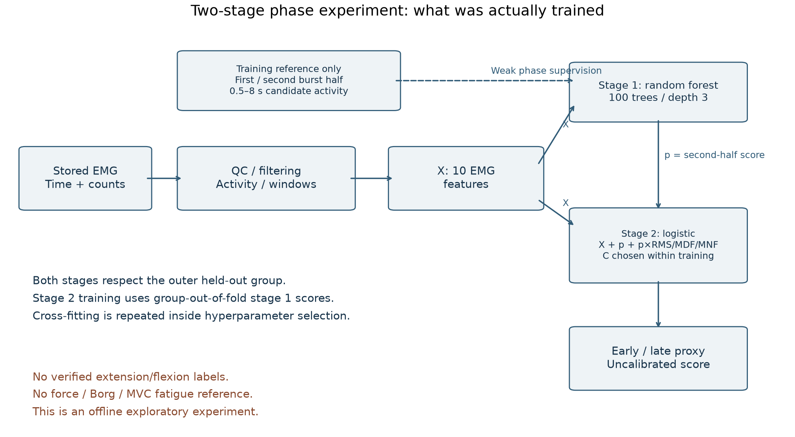

# sEMG temporal-position proxy classification

**Entrega estructurada:** abrir [LÉEME PRIMERO](LEEME_PRIMERO.md), el [informe de evidencias](docs/INFORME_EVIDENCIAS.md) y el [mapa entre afirmaciones, artículo, diapositivas y archivos](docs/MAPA_EVIDENCIA.csv). El ZIP privado conserva el artículo, la presentación vigente, datos, modelos y comprobantes. El [verificador portátil](tools/verify_delivery.py) comprueba todos los archivos del paquete y su snapshot del código.

La [respuesta técnica a los comentarios del docente](docs/PROFESSOR_FEEDBACK_RESPONSE_2026-11-09.md) documenta el análisis del proyecto del curso. Los resultados nuevos con etiquetas temporales de autorreporte, obtenidas independientemente de la señal EMG, se resumen abajo y tienen archivos agregados reproducibles. El ZIP del curso contiene EMG sin fuerza calibrada ni cinemática sincronizada; por eso sus resultados no acreditan fatiga fisiológica ni extensión/flexión observadas.

La [auditoría de datos de referencia](docs/REFERENCE_DATA_REQUIREMENTS.md) enumera presencia, ruta, unidades, resolución temporal, calibración, sincronización, granularidad y límites para cada fuente. La [matriz de cumplimiento del docente](docs/PROFESSOR_REQUIREMENTS_COMPLIANCE_2026-11-09.csv) vincula cada requisito con evidencia y su alcance.

## Defense presentation

The revised private defense follows the signal-analysis workflow in **16 principal slides (600 seconds) and 14 evidence appendices**: corpus, signal, quantitative signal-quality preanalysis, preprocessing, windowing, labels, features, grouped validation, model families and proxy performance, auxiliary architecture and results, candidate-feature audit, equations, and the proposed reference-backed direct/cascade/expert comparison. Repetition- and phase-aligned feature trajectories are reported as unavailable without synchronized verified markers. It removes the former administrative closing block. See the [slide-by-slide storyboard](docs/DEFENSE_STORYBOARD.md).

The [input builder](tools/build_defense_inputs.py) verifies the frozen evaluation receipts and prepares private signal snippets and numerical summaries. The [presentation builder](tools/build_defense_v2.mjs) creates editable tables, charts, confusion matrices, window and reference-architecture diagrams, and Spanish/English speaking scripts. The [signal-evidence builder](tools/build_signal_evidence.py) creates a private anonymized figure with a real waveform, Hann periodograms and the sampling-rate-specific filter response. Its image and receipt belong in the private package and must not be committed. The only PDFs in this public repository are the read-aloud scripts; participant-level signals, private input JSON, manuscript PDF and presentation PDF/PPTX remain private.

### Slide-by-slide defense scripts

Read or edit the [Spanish Markdown](docs/defense-scripts/Guion_defensa_ES.md) and [English Markdown](docs/defense-scripts/Defense_Script_EN.md), or open the [Spanish PDF](docs/defense-scripts/pdf/Guion_defensa_ES.pdf) and [English PDF](docs/defense-scripts/pdf/Defense_Script_EN.pdf). Each version covers all 30 slides in presentation order: 16 principal slides scheduled for 600 seconds and 14 question appendices. The scripts retain the central scientific qualification: the executed models predict an early/late temporal proxy, not independently measured muscle fatigue or observed knee extension/flexion.

```powershell
python tools/build_defense_inputs.py --root '<private-frozen-output>' --archive '<authorized-primary-ZIP>' --output '<private-frozen-output>/slides_input_v2.json'
# Run a copy of tools/build_defense_v2.mjs from a private build directory with
# @oai/artifact-tool from the bundled Codex runtime, and environment variables
# EMG_PRESENTATIONS_SKILL and EMG_RUNTIME_PYTHON. Preserve report_assets/.
# node build_defense_v2.mjs '<private-frozen-output>' presentation_reorganized
```

## Supplemental two-stage phase experiment

The completed exploratory cascade did **not show a clear improvement**. On the same 5,509 windows and 15 held-out groups, direct ten-feature logistic regression obtained Accuracy **0.6752 ± 0.0935** and macro-F1 **0.6355 ± 0.1262**; the phase-conditioned variant obtained Accuracy **0.6701 ± 0.1022** and macro-F1 **0.6293 ± 0.1330**. Paired Accuracy difference: **−0.0051**, 95% group-bootstrap interval **[−0.0222, +0.0095]**; paired macro-F1 difference: **−0.0062**, interval **[−0.0232, +0.0082]**. Both intervals include zero. These are temporal-proxy results only. The original primary model remains unchanged.

Stage 1 is a separate random forest learning **first/second EMG activity-burst halves**, not verified knee extension/flexion. Stage 2 is a logistic classifier using EMG features and the stage 1 score to predict the weak early/late target. Both stages use grouped cross-fitting inside nested validation. No independent physiological fatigue reference is introduced.




See the **[full supplemental report and model relationships](docs/PHASE_EXPERIMENT.md)**, [commented references](docs/PHASE_REFERENCES.md), [all 12 target-specific confusion matrices](results/phase_experiment/confusion_matrices.csv), [aggregate/fold results](results/phase_experiment), [original experiment source and reproduction instructions](experiments/phase_proxy), and [evidence tests](tests/test_phase_evidence.py). Absolute and row-normalized matrices for all six primary procedures, five supplemental variants and the auxiliary head are shown in the report. Full OOF, manuscript, slide deck and models remain in the updated private delivery.

The **[executed proxy architecture](docs/figures/executed_proxy_architecture_es.svg)** distinguishes the early/late target and burst-half auxiliary task. The **[reference-backed target architecture](docs/figures/reference_fatigue_architecture_es.svg)** is clearly marked as proposed because synchronized force/torque and kinematics are not present. Both diagrams can be rebuilt with `python tools/build_reference_architecture.py`.

The supplemental `baseline_10` reproduces primary `logistic_all`; it is different from the primary nested selector (macro-F1 0.6240). The auxiliary RF, primary RF family and final serialized RF are different fits and roles, explicitly related in the model map. This experiment does not establish verified extension recognition, physiological fatigue or robustness to unseen acquisition domains.

The historical course-cohort classifier predicts **early versus late recording position**. Its class is a temporal proxy, not a physiological fatigue label. A separate experiment below evaluates a time-stamped self-report reference from an external dataset. It still does not establish mechanical fatigue, force loss, or fatigue onset.

## External self-reported fatigue benchmark — run_001

The new benchmark uses version 2 of the [Zenodo sEMG and self-perceived-fatigue dataset](https://zenodo.org/records/14182446) described by [Cerqueira et al.](https://pmc.ncbi.nlm.nih.gov/articles/PMC11678945/). It contains 13 participants, 156 trials, four upper-limb channels per trial (biceps and anterior, middle and posterior deltoid), voltage signals and time-stamped self-reports. The target is explicitly **PERCEIVED_FATIGUE_CLASSIFICATION**: stable label 0 maps to no self-reported fatigue; stable label 2 maps to self-reported fatigue; transition label 1 is excluded. These labels are not force-loss or clinical measurements.

The prediction unit is a **stable 500 ms window** with 50% overlap, wholly covered by one reference state. The recorded sampling rate was 1259.26 Hz. Preprocessing estimated each channel's time base and checked gaps, non-monotonic clocks, nonfinite values and flat runs. It removed 54 unambiguous terminal clock-reset rows across 42 trials; no gaps or non-monotonic intervals remained in the 624 processed channel-trial records. The sensor rail limits were unavailable, so hardware clipping could not be assessed. Filtering used a Butterworth bandpass with prototype order 4, 20–450 Hz cutoffs, SOS implementation and zero-phase application. A 50/60 Hz notch was conditional on a line-prominence threshold and was not triggered in these records. The four-channel feature vector includes amplitude, waveform length, spectral, band-power, entropy and db4 wavelet measures. Full formulas and parameter definitions are in [`perceived_dataset.py`](src/emg_fatigue/perceived_dataset.py) and [`perceived_preprocessing.py`](src/emg_fatigue/perceived_preprocessing.py).

Processing retained 125,165 eligible windows: 64,283 without perceived fatigue and 60,882 with perceived fatigue. Leave-one-participant-out (13 folds) kept every participant wholly in train or test; the same held-out windows were used for each model. The training split used at most 50 evenly time-spaced windows per training participant × trial × class cell; all held-out windows were retained. Time, participant and trial identifiers were not inputs to EMG classifiers. A separate time-only logistic model is a shortcut diagnostic.

| Model | Pooled OOF accuracy | Pooled OOF macro-F1 |
| --- | ---: | ---: |
| Majority baseline | 0.514 | 0.339 |
| Logistic regression | 0.621 | 0.621 |
| SVM-RBF | 0.597 | 0.597 |
| Random forest | 0.634 | 0.634 |
| HistGradientBoosting | **0.655** | **0.655** |
| Compact MLP | 0.613 | 0.613 |
| Time-only control | **0.940** | **0.940** |

HistGradientBoosting, the strongest descriptive EMG-only result, had participant-macro accuracy 0.656 (95% participant-bootstrap CI 0.611–0.698) and macro-F1 0.630 (0.585–0.670). The time-only control reached 0.941 (0.911–0.966) and 0.937 (0.904–0.965), respectively. In paired participant bootstrap comparisons, HistGradientBoosting minus time-only was −0.285 accuracy (95% CI −0.349 to −0.220) and −0.308 macro-F1 (−0.370 to −0.248); EMG was higher on neither metric for any of the 13 held-out participants. Paired differences for every EMG model are in [`paired_delta_vs_time_only.csv`](results/reference_fatigue/paired_delta_vs_time_only.csv). This shows strong temporal confounding and **does not support a useful fatigue detector from these EMG features**. Hyperparameters were fixed; the best OOF row is descriptive and is not an unbiased post-selection estimate.

The [aggregate benchmark metrics](results/reference_fatigue/benchmark_metrics.csv), [paired differences](results/reference_fatigue/paired_delta_vs_time_only.csv), [pooled confusion counts and row-normalized rates](results/reference_fatigue/confusion_matrices.csv), and [public run receipt](results/reference_fatigue/run_manifest.json) provide auditable aggregate evidence. Individual OOF predictions, per-participant metrics and signals stay local and are ignored by Git. The source pipeline is [`prepare_dataset.py`](experiments/reference_fatigue/prepare_dataset.py), [`run_benchmark.py`](experiments/reference_fatigue/run_benchmark.py), and [`export_public_evidence.py`](experiments/reference_fatigue/export_public_evidence.py). Reproduction requires both dataset ZIPs from the cited record; the receipt records their official MD5 and SHA-256 hashes.

```powershell
$env:EMG_ZIP = 'C:\private-data\sEMG_data.zip'
$env:LABELS_ZIP = 'C:\private-data\self_perceived_fatigue_index.zip'
$env:RUN_DIR = 'C:\private-results\reference_fatigue\run_001'
$env:PUBLIC_DIR = 'results/reference_fatigue'
python experiments/reference_fatigue/prepare_dataset.py --emg-zip $env:EMG_ZIP --labels-zip $env:LABELS_ZIP --output-dir $env:RUN_DIR
python experiments/reference_fatigue/run_benchmark.py --output-dir $env:RUN_DIR --sample-cap 50 --seed 20261109
python experiments/reference_fatigue/export_public_evidence.py --run-dir $env:RUN_DIR --output-dir $env:PUBLIC_DIR
```

This dataset has no synchronized extension/flexion reference or objective force-loss reference. Therefore, this benchmark does not train or evaluate a phase classifier, a phase-to-fatigue cascade, or an objective mechanical-fatigue classifier. The course archive remains separate and still lacks those references; see the [reference-data checklist](docs/REFERENCE_DATA_REQUIREMENTS.md).

The original exploratory project is retained separately: [proyecto-biomecanica-emg](https://github.com/EthanGL1/proyecto-biomecanica-emg/tree/772b7a39c18ecfd34bfbd5f20fa0a14d2ddfa003). This repository implements a new binary task; its metrics must not be substituted for the old three-class scores or for Borg/Cerqueira results from other tasks.

## What runs

- CSV/ZIP/RAR readers, input hashes, clock and signal QC, gap-preserving filtering and explicit abstention.
- Historical proxy pipeline: candidate activity segmentation followed by complete 250 ms windows with 50% overlap. The external perceived-fatigue benchmark uses the completed 500 ms / 50% overlap contract described above.
- Amplitude, spectral and wavelet features; mandatory majority and RMS+MDF logistic baselines.
- Outer leave-one-recording-group-out evaluation with grouped inner tuning. Both sides and all series of a group stay together. Group-to-person identity is an explicit, unverified assumption of the source folder structure.
- Model serialization, checksum verification, reloading and prediction using exactly the training feature schema.
- Prespecified sensitivity analyses, feature-family ablations, numerical tables and figures generated from frozen out-of-fold outputs.

## Installation

Python 3.12. Use the exact tested distributions and release-file SHA256 hashes:

```powershell
python -m venv .venv
.\.venv\Scripts\python.exe -m pip install --require-hashes -r requirements-lock.txt
.\.venv\Scripts\python.exe -m pip install --no-deps --no-build-isolation -e .
.\.venv\Scripts\python.exe -m pytest -q
```

The lock records the tested Windows environment and includes official PyPI release hashes for alternative compatible wheels. CI checks a clean Linux environment separately. `requirements.in` is the frozen distribution list used to produce this lock, not an invitation to upgrade dependencies during reproduction.

## Reproduce with authorized course data

Keep the original archive and all derived outputs **outside this checkout**. Set one input and one output root:

```powershell
$env:EMG_DATA_ZIP = 'C:\authorized-private-storage\recordings.zip'
$env:EMG_OUTPUT_ROOT = Join-Path $env:LOCALAPPDATA 'EMG_Biomecanica\binary-study'
.\.venv\Scripts\python.exe -m emg_fatigue features --config configs/study.yaml
.\.venv\Scripts\python.exe -m emg_fatigue evaluate --config configs/study.yaml
.\.venv\Scripts\python.exe -m emg_fatigue fit-final --config configs/study.yaml
.\.venv\Scripts\python.exe -m emg_fatigue sensitivities --config configs/study.yaml
.\.venv\Scripts\python.exe -m emg_fatigue report --config configs/study.yaml
```

`features` generates upstream inventory, preprocessing, labels and feature products together. The separate inventory/preprocess/labels commands are available for inspection. `evaluate` and `fit-final` reject a cache whose configuration or byte hash differs from its processing receipt. `fit-final` performs grouped inner selection on the full development cohort; its fit is not another held-out performance estimate. Use the nested selection procedure's OOF result to describe selection performance.

The primary archive layout is one folder per recording group, with CSV filenames containing an unambiguous `R0`–`R5` and `dr`/`iz`. CSV columns are exactly `Relative_Time_s,ADC_Value[,Voltage_mV]`. `Voltage_mV` is not used: its conversion does not establish physical calibration. R0 controls remain out of formal training.

The additional RAR format `Pxx_set01_dr.csv` is supported for separate processing. A different filename is not evidence of a different person. Do not pool it with the primary cohort or call it external validation without reconciling identity and session provenance.

## Prediction

```powershell
.\.venv\Scripts\python.exe -m emg_fatigue predict --config configs/study.yaml --input 'C:\private\recording.csv' --model "$env:EMG_OUTPUT_ROOT\model.joblib"
```

Or replace `--input` with `--fragments part1.csv part2.csv part3.csv`. Fragments retain original timestamps, are ordered and reassembled before filtering; overlap and clock resets are rejected. This is offline reassembly, not streaming inference.

Prediction loads the bundle's processing contract. Valid candidate-active windows in the trained early/late support receive a class and a score. Quality failures, undetected activity, invalid features and the excluded transition receive distinct abstention reasons. Native probabilities are marked uncalibrated; SVM scores are sigmoid-transformed decision margins, not calibrated probabilities. Load only a trusted locally produced joblib bundle: its checksum receipt provides integrity, not authenticity.

## Public synthetic smoke test

```powershell
.\.venv\Scripts\python.exe -m emg_fatigue demo --output-dir "$env:TEMP\emg-synthetic-demo"
```

This exercises signal processing, grouped evaluation, serialization and figures without course data. The signals are deterministic software fixtures, not a physiological EMG simulation, and their scores do not describe real fatigue detection.

## Report and evidence

The frozen numerical comparison is in [docs/RESULTS.md](docs/RESULTS.md), with the [model card](docs/MODEL_CARD.md). The nested selector's observed macro-F1 does not clearly improve on the mandatory RMS+MDF logistic baseline.

Every numerical table and figure has a source mapping in private `report_assets/table_sources.json`. `results.csv` in private output has one row per model × outer fold, all required metrics, support and confusion counts. Public `results/results.csv`, when present, contains only whitelisted fold metrics with opaque IDs; it contains no subject identity, paths, signal windows or granular predictions. The private export mapping is not published.

The complete editable manuscript follows the supplied template and remains private with the course data. The report generator takes the template locally; this repository does not redistribute the university template, participant data or the previous private manuscript. The core bibliography contains ten DOI-indexed sources in `references/verified_references.json`; the manuscript adds three phase-specific sources from `references/phase_references.json` when the supplement is included, for thirteen references total.

See [the protocol](docs/protocol.md), [the data dictionary](docs/data_dictionary.md), [discrepancy resolution](docs/discrepancy_resolution.md), [privacy boundaries](docs/privacy.md) and [the execution ledger](docs/EXECUTION_LEDGER.md).
