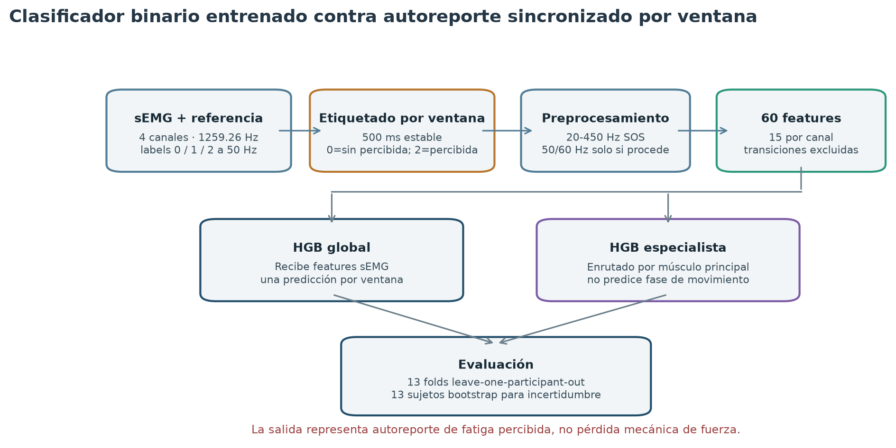
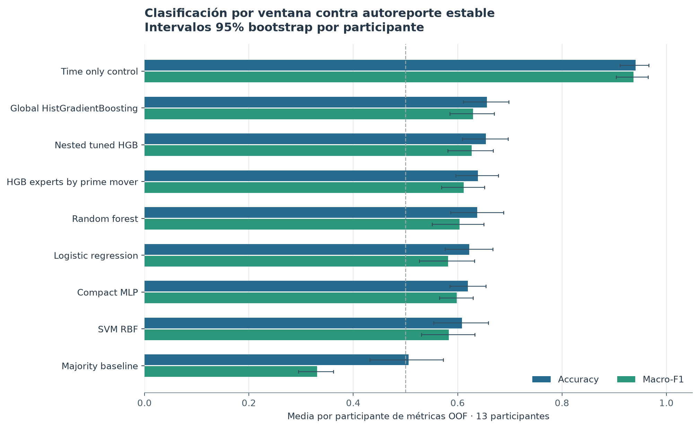
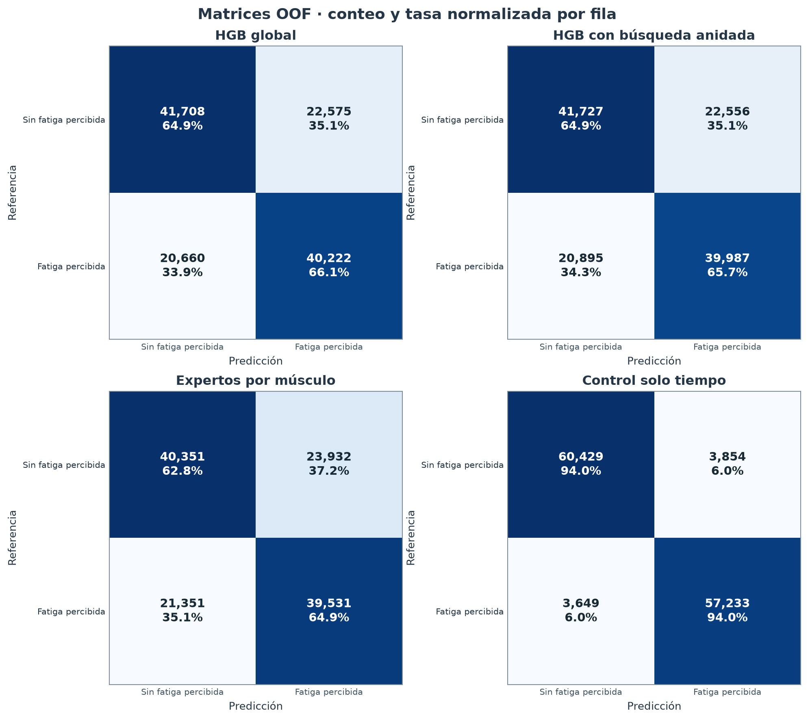
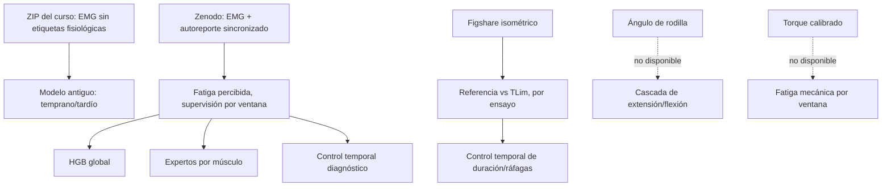

# Experimento binario por ventana con etiquetas de referencia

## Resultado que responde al comentario del docente

El clasificador del ZIP original sigue aprendiendo posición temporal temprana/tardía. No predice fatiga muscular. Para comprobar una tarea por ventana sin inventar clases, se entrenó otro experimento con EMG y autoreportes sincronizados de fatiga percibida. Esto demuestra supervisión binaria por ventana; no demuestra pérdida mecánica de fuerza ni fatiga muscular objetiva.

La fuente contiene 13 personas, 156 ensayos de movimientos del tren superior, cuatro canales sEMG y niveles de autoreporte 0, 1 y 2. La versión 2 registra EMG a 1259,26 Hz y autoreportes a 50 Hz. [Registro oficial Zenodo](https://zenodo.org/records/14182446).

- `0`: autoreporte estable de ausencia de fatiga percibida.
- `1`: transición, excluida del contraste binario.
- `2`: autoreporte estable de fatiga percibida.

La variable objetivo que recibe el clasificador se codifica explícitamente como binaria: etiqueta fuente estable `0 → y=0` y etiqueta fuente estable `2 → y=1`. No se entrena contra la clase fuente de transición `1`.

Una ventana recibe una clase solo si todo el intervalo de 500 ms queda cubierto por un mismo estado estable. Se excluyen ventanas que cruzan una transición, cambio de estado o hueco de referencia. El conjunto final tiene 125.165 ventanas: 64.283 sin fatiga percibida y 60.882 con fatiga percibida.



## Auditoría y preanálisis de la señal

Cada ensayo aporta cuatro pares sincronizados de tiempo y voltaje: bíceps y deltoides anterior, medio y posterior. La auditoría cubrió 156 ensayos y 624 registros canal por ensayo. Retiró 54 filas finales con retroceso inequívoco del reloj, de 42 ensayos. Después de limpiarlas no quedaron huecos ni intervalos no monótonos en los registros procesados. Los límites eléctricos del sensor no se publican, así que el recorte por saturación no se puede evaluar.

La frecuencia se estima desde los timestamps: `Δt_med = mediana(t[n+1]−t[n])`, `fs=1/Δt_med`. El umbral de hueco es `max(1,5 ms, 1,5×Δt_med)`. Los huecos separan segmentos; el filtro no los atraviesa. Se centra cada tramo continuo antes de filtrarlo.

## Filtro, ventana y espectro

Se aplica Butterworth pasa banda de 20–450 Hz, prototipo de orden 4, en secciones de segundo orden (SOS). La tasa de Nyquist observada es 629,63 Hz. El orden digital final del pasa banda es `2n=8`.

```text
|Ha(jΩ)|² = 1 / (1 + (Ω/Ωc)^(2n))
H(z) = producto_r [(b0,r+b1,r z⁻¹+b2,r z⁻²) /
                    (a0,r+a1,r z⁻¹+a2,r z⁻²)]
```

`sosfiltfilt` filtra hacia adelante y hacia atrás: la respuesta tiene fase cero y el análisis es offline. Los coeficientes dependen de la tasa medida y se guardan en el recibo. Se enmascaran los bordes de cada segmento. La prominencia de línea usa `L_f=10log10(PSD(f)/mediana(PSD vecina))`; se aplica `iirnotch(f0,Q=30,fs=fs)` convertido a SOS solo si supera 10 dB. No se activó ningún notch de 50/60 Hz en esta cohorte.

Para `T=0,5 s`, `ρ=0,5`, `fs≈1259,26 Hz`:

```text
N = round(T×fs) = 630 muestras
H = round(N×(1−ρ)) = 315 muestras
Δf = fs/N ≈ 2 Hz
x_i[n] = x[iH+n], n=0,…,N−1
```

El espectro usa periodograma unilateral de densidad con ventana Hann:

```text
w[n] = 0,5(1−cos(2πn/(N−1)))
Xw[k] = Σ x[n]w[n]exp(−j2πkn/N)
Pxx[k] = ck|Xw[k]|²/(fs Σw[n]²)
```

`ck=2` para bins positivos interiores y `ck=1` en DC y Nyquist. El código usa `scipy.signal.periodogram(window='hann', detrend=False, scaling='density')`, no Welch para las features. El solapamiento genera ventanas dependientes; la incertidumbre se remuestrea por persona.

## Features y fórmulas

Cada canal tiene 15 features, 60 en total:

| Feature | Fórmula | Unidades / alcance |
|---|---|---|
| RMS | `sqrt(Σx²/N)` | V |
| MAV | `Σ|x|/N` | V |
| Longitud de onda | `Σ|x[n]−x[n−1]|` | V por ventana |
| Longitud de onda por segundo | `Σ|Δx| / ((N−1)/fs)` | V/s |
| iEMG | `Σ|x|/fs` | V·s |
| MDF | primer `f_m` con `Σ(f≤f_m)Pxx ≥ 0,5ΣPxx` | Hz |
| MNF | `ΣfPxx/ΣPxx` | Hz |
| Potencia relativa | `Σ_{f∈B}PxxΔf / Σ_{20≤f≤450}PxxΔf` | Bandas 20–60, 60–150, 150–450 Hz |
| Entropía espectral | `−Σp[k]ln p[k]/ln(K)`, `p=Pxx/ΣPxx` | 0 a 1 |
| Energía wavelet relativa | `E_j=Σc_j[m]² / Σ_{q∈{A3,D3,D2,D1}}Σc_q[m]²` | db4, nivel 3, extensión simétrica |

## Modelos y validación

Se compararon regresión logística, SVM RBF, random forest, HistGradientBoosting, MLP compacto y baseline mayoritario. El control temporal recibe solo la fracción temporal del ensayo y funciona como diagnóstico de atajo, no como clasificador EMG.

La predicción es por ventana y la partición por persona: 13 pliegues leave one participant out. Todas las ventanas de una persona quedan juntas. Para entrenar, se toman como máximo 50 ventanas espaciadas temporalmente por persona × ensayo × clase; las ventanas de prueba se conservan completas. Los hiperparámetros iniciales se fijaron antes de evaluar sujetos externos. También se ejecutó una búsqueda anidada del HGB, seleccionando con GroupKFold por persona dentro del conjunto de entrenamiento de cada pliegue externo.

## Rendimiento del detector por ventana

HistGradientBoosting obtuvo Accuracy pooled OOF 0,655 y macro-F1 0,655. Sus promedios por persona fueron Accuracy 0,656 (IC 95% 0,611–0,698) y macro-F1 0,630 (0,585–0,670). La etiqueta es autoreporte de fatiga percibida, no fuerza.

El control que ve solo tiempo alcanzó Accuracy y macro-F1 0,940, con intervalos por persona 0,911–0,966 y 0,904–0,965. Ninguno de los modelos EMG superó el control en un solo sujeto para estas métricas. La diferencia pareada HGB menos control fue −0,285 para Accuracy (IC 95% −0,349 a −0,220) y −0,308 para macro-F1 (−0,370 a −0,248). El atajo temporal domina; el experimento corrige las etiquetas, pero no demuestra que EMG generalice como detector de fatiga.



## Cabezas especialistas

Se probó un HistGradientBoosting por músculo principal conocido, enrutado con la tarea indicada en la fuente. Cada experto recibe solo features EMG. El macro-F1 pooled bajó de 0,655 con HGB global a 0,638 con especialistas. Los promedios por persona cambiaron de 0,656 a 0,639 en Accuracy, y de 0,630 a 0,612 en macro-F1. La diferencia pareada especialista menos global fue −0,0174 en Accuracy (IC 95% −0,0267 a −0,0070) y −0,0177 en macro-F1 (−0,0267 a −0,0075). La especialización por músculo/tarea no mejoró. Esto no evalúa expertos de extensión/flexión.



## Búsqueda anidada

Se evaluaron 16 combinaciones sin consultar el pliegue externo: `max_iter ∈ {75,150}`, `learning_rate ∈ {0,03,0,08}`, `max_leaf_nodes ∈ {7,15}`, `l2_regularization ∈ {1,10}`. Se selecciona el mayor macro-F1 promedio por participante en tres folds GroupKFold. El modelo elegido se entrena con todo el entrenamiento externo y se prueba una vez en la persona retenida. `nested_hgb_*.csv` conserva los resultados agregados, matrices y parámetros seleccionados por pliegue; `nested_hgb_manifest.json` vincula sus hashes.

Este estimador es el procedimiento anidado completo, no un modelo retrospectivo elegido por su resultado. En LOPO, su Accuracy media por participante fue 0,654 (IC 95% 0,609–0,697) y macro-F1 0,627 (0,581–0,668). La matriz OOF fue `[[41727,22556],[20895,39987]]`. El contraste con el HGB fijo usa las mismas 125.165 ventanas OOF y bootstrap pareado por participante: Δ Accuracy −0,0019 (IC 95% −0,0076 a 0,0033) y Δ macro-F1 −0,0029 (−0,0099 a 0,0032). Solo 5 de 13 participantes tuvieron Accuracy mayor y 6 de 13 macro-F1 mayor con ajuste anidado. No se detecta una mejora.

La misma comparación aparece en `nested_hgb_paired_differences.csv`; `nested_hgb_confusion.csv` conserva conteo y tasa por clase; `nested_hgb_selected_params.csv` deja los parámetros de cada sujeto retenido. El recibo calcula hashes de las tablas agregadas y de las predicciones OOF privadas.

## Benchmark complementario a nivel de ensayo

El dataset público de Rossato et al. aporta ensayos isométricos de rodilla al 30% del torque máximo: contracciones de referencia y TLim sostenido hasta el fallo. Se analizaron 14 pares completos, 28 ensayos a 2048 Hz. Las clases pertenecen al ensayo completo; nunca se replican como estados de cada ventana. Un `ref_signal` no calibrado segmenta actividad y queda fuera de las features y las etiquetas. [Rossato et al., Journal of Neurophysiology (2022)](https://pubmed.ncbi.nlm.nih.gov/35020505/).

La segmentación suaviza fuerza con mediana de 100 ms, define `umbral=P5+0,20(P95−P5)`, une huecos ≤250 ms y retiene ráfagas ≥10 s. Se filtra 20–450 Hz en SOS, se enmascaran 100 ms por borde y se usan ventanas de 500 ms / 50% de solapamiento. Ocho mediciones EMG por ventana se resumen por ensayo con mediana, IQR y pendiente:

```text
IQR(x) = Q75(x) − Q25(x)
pendiente = Σ(t−t̄)(x−x̄) / Σ(t−t̄)²
```

La CNN MIL usa ocho ventanas distribuidas por ensayo, promedia sus logits y calcula una sola pérdida binaria por ensayo. Las otras familias reciben vectores agregados. Se dejaron fuera dos ensayos de cada sujeto mediante LOPO con ajuste interno agrupado.

La logística EMG RMS+MDF y la logística de ocho features alcanzaron Accuracy/macro-F1 0,964/0,964 de 28 ensayos; la CNN alcanzó 0,679/0,678. El control de duración, número y longitud de ráfagas obtuvo 1,000/1,000. El protocolo también separa clases: cuatro ráfagas en referencia y una en TLim. Ese resultado perfecto evidencia un atajo de protocolo. Esta tarea no estima fatiga instantánea por ventana ni se equipara a las grabaciones dinámicas del curso.

| Procedimiento | Accuracy | Macro-F1 | Matriz `[[TN, FP], [FN, TP]]` |
|---|---:|---:|---|
| Control temporal y de ráfagas | 1,000 | 1,000 | `[[14,0],[0,14]]` |
| Logística EMG, ocho features | 0,964 | 0,964 | `[[14,0],[1,13]]` |
| CNN 1D MIL | 0,679 | 0,678 | `[[9,5],[4,10]]` |
| HGB | 0,500 | 0,333 | `[[14,0],[14,0]]` |

## Relación entre objetivos y arquitecturas



El modelo HGB y los especialistas predicen autoreporte estable por ventana. El benchmark Figshare predice resultado de ensayo. El proyecto original sigue prediciendo posición temporal. Ninguna tarea ofrece métricas experimentales de fatiga muscular mecánica en el ZIP universitario.

Zhu et al. estudiaron cómo la fatiga afecta clasificadores sEMG de fase de marcha y evaluaron una estrategia de entrenamiento de robustez. Ese trabajo motiva controlar la fatiga al clasificar fase; no demuestra que una etapa fase→fatiga mejore el detector. [Zhu et al., Applied Sciences (2021)](https://www.mdpi.com/2076-3417/11/9/3821).

No se transfirió el codificador SSL del curso: usa una entrada de un canal y reconstrucción sin etiqueta, mientras que los datasets externos usan cuatro o 65 canales y protocolos diferentes. La identidad de participantes entre cohortes no está verificada. Reinforcement learning tampoco aplica a esta clasificación estática sin acciones ni recompensas secuenciales.

## Código y archivos

- `experiments/reference_fatigue/prepare_dataset.py`: alineamiento de autoreporte, filtros y 60 características.
- `experiments/reference_fatigue/run_benchmark.py`: comparación por ventana y control temporal.
- `experiments/reference_fatigue/prime_mover_specialists.py`: comparación de especialistas por músculo/tarea.
- `experiments/reference_fatigue/nested_hgb_benchmark.py`: búsqueda HGB anidada.
- `experiments/reference_fatigue/figshare_trial_model.py` y `figshare_trial_benchmark.py`: benchmark por ensayo.
- `results/reference_fatigue/`: matrices, contrastes pareados, selección por fold y recibos agregados. Predicciones granulares y señales quedan privadas.

## Referencias

1. Cerqueira S, Vilas-Boas R, Figueiredo J, Santos C. *A Dataset of sEMG and Self-Perceived Fatigue Levels for Muscle Fatigue Analysis*. Zenodo v2. [10.5281/zenodo.14182446](https://doi.org/10.5281/zenodo.14182446).
2. Rossato J et al. *Less common synaptic input between muscles from the same group allows for more flexible coordination strategies during a fatiguing task*. Journal of Neurophysiology. 2022;127(2):421–433. [10.1152/jn.00453.2021](https://doi.org/10.1152/jn.00453.2021).
3. Zhu J et al. *The Muscle Fatigue’s Effects on the sEMG-Based Gait Phase Classification: An Experimental Study and a Novel Training Strategy*. Applied Sciences. 2021;11(9):3821. [10.3390/app11093821](https://doi.org/10.3390/app11093821).
