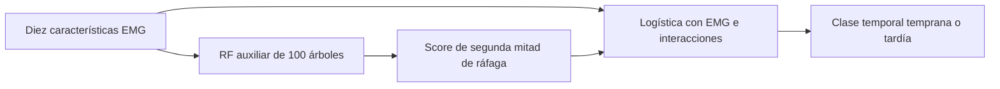

# Informe de evidencias del proyecto EMG

La entrega reconstruye una ruta reproducible desde los registros sEMG hasta las predicciones, compara seis procedimientos principales y prueba cinco variantes de una cascada auxiliar. La comparación por grupos no mostró una mejora clara al incorporar el score de fase. Este documento permite localizar la evidencia de cada conclusión sin confundir ventanas, grupos, modelos o referencias de clase.

El artículo completo se entrega en `EMG_Binary_Report.pdf` y `.docx`: 21 páginas y 13 referencias. La presentación vigente tiene 16 diapositivas principales para 600 segundos y 7 anexos. El [mapa de evidencia](MAPA_EVIDENCIA.csv) proporciona las correspondencias exactas. Los registros privados mencionados abajo están dentro del ZIP, bajo las rutas indicadas en el mapa.

## Corpus y señal

El ZIP principal contiene 140 CSV y 4.256.257 muestras. Las 138 grabaciones R1–R5 entran al procesamiento formal y dos R0 permanecen como controles. Hay 15 grupos derivados de carpetas. El reloj observado es aproximadamente de 1.000 Hz. Los archivos aportan tiempo relativo y cuentas ADC. La identidad individual, el modo eléctrico y la calibración física carecen de una referencia independiente.

El RAR adicional contiene 20 CSV de dos códigos y permanece separado. No se suma como dos personas verificadas ni como validación externa. El inventario, los hashes y las exclusiones se conservan para comprobar los denominadores. [Resultados y alcance del corpus](RESULTS.md), [diccionario](data_dictionary.md).

| Paso del procesamiento formal | Ventanas |
|---|---:|
| Candidatas | 33.090 |
| Calidad temporal válida | 32.474 |
| Actividad y características válidas | 9.289 |
| Etiqueta temprana o tardía elegible | 5.509 |

La referencia final contiene 2.329 ventanas tempranas y 3.180 tardías. Las ventanas no constituyen personas independientes.

## Preanálisis, procesamiento y etiquetas

El control previo revisa reloj, huecos, jitter, señal constante y repetición de extremos. Las curvas descriptivas de RMS/MDF/MNF usan medianas por registro y decil, después por grupo, y finalmente medias entre grupos. No crean la etiqueta ni establecen por sí solas un mecanismo de fatiga.

Los huecos mayores que el máximo de 1,5 ms y 1,5 veces el intervalo mediano separan tramos. El jitter relativo mayor a 5% invalida el tramo. Cada tramo válido se centra y filtra con Butterworth 20–400 Hz, prototipo de orden 4, aplicación bidireccional y exclusión de 100 ms por borde. La rama espectral conserva señal sin rectificar. El notch está desactivado en el principal.

La actividad candidata usa RMS de 50 ms, avance de 25 ms y umbral Otsu por registro. Las ventanas completas duran 250 ms, se solapan 50% y requieren ocupación activa de al menos 75%. Los tercios se calculan sobre los tiempos originales antes de las exclusiones: clase 0 en el primero y clase 1 en el último. Centro, fronteras, fallos de calidad y ausencia de actividad quedan fuera del contraste.

Las diez características son RMS, MAV, longitud de forma de onda por segundo, MDF, MNF, razón de potencia 20–60/60–400 Hz y cuatro energías relativas wavelet db4 A3/D3/D2/D1. Tiempo, identidad, pierna y serie no entran como predictores. [Contrato](protocol.md), [configuración](../configs/study.yaml), [preprocesamiento](../src/emg_fatigue/preprocessing.py), [características](../src/emg_fatigue/features.py).

## Metodología y rendimiento principal

La validación externa retiene cada grupo completo una vez. Ambas piernas y todas las series permanecen juntas. Cuatro particiones agrupadas internas seleccionan parámetros usando macro-F1 medio por grupo. Escalador y modelo se ajustan sólo con entrenamiento. Las predicciones OOF y las búsquedas internas quedan guardadas. Los intervalos pareados usan bootstrap de los 15 grupos.

| Procedimiento | Macro-F1 media ± DE | AUC media |
|---|---:|---:|
| Mayoría | 0,3598 ± 0,0349 | 0,5000 |
| Logística RMS + MDF | 0,6272 ± 0,0980 | 0,7430 |
| Logística de diez características | 0,6355 ± 0,1262 | 0,8447 |
| SVM RBF | 0,6363 ± 0,1343 | 0,8039 |
| Random forest | 0,6366 ± 0,1259 | 0,8170 |
| Selector anidado | 0,6240 ± 0,1292 | 0,7984 |

El selector frente a RMS+MDF presenta diferencia media −0,0032 e IC 95% [−0,0591, +0,0509]. No hay ventaja clara del procedimiento complejo. Elegir retrospectivamente la mejor familia observada produciría una comparación distinta de la prespecificada. [Resultados principales](RESULTS.md), [modelo](MODEL_CARD.md).

La matriz OOF del selector es `[[1473,856],[995,2185]]`, con filas de referencia y columnas de predicción. Los promedios por grupo se distinguen de métricas calculadas sobre esta matriz agrupada.

## Arquitectura auxiliar y relación entre modelos

La primera etapa aprende primera/segunda mitad de ráfagas EMG de 0,5–8 s. Usa RF de 100 árboles, profundidad 3 y mínimo 5 muestras por hoja. La referencia auxiliar contiene 3.337 ventanas, 1.663 primeras y 1.674 segundas mitades, de 996 ráfagas candidatas. La segunda etapa conserva los diez features y añade score y, en la variante principal, score×RMS/MDF/MNF. Sus scores de entrenamiento se obtienen fuera de muestra por grupo, repitiendo el procedimiento dentro de la selección interna.

El RF final principal tiene 300 árboles y es otro ajuste. El selector anidado elige una configuración, no combina votos. El directo suplementario `baseline_10` reproduce `logistic_all`; esta igualdad evita atribuir a la fase diferencias entre comparadores. [Arquitectura detallada](PHASE_EXPERIMENT.md), [registro de funciones](../results/phase_experiment/model_registry.csv), [fuente y protocolo original](../experiments/phase_proxy).

## Resultados auxiliares

| Variante de la segunda etapa | Macro-F1 media ± DE | AUC media |
|---|---:|---:|
| Directo de diez características | 0,6355 ± 0,1262 | 0,8447 |
| EMG + score | 0,6326 ± 0,1314 | 0,8422 |
| Condicionado por fase | 0,6293 ± 0,1330 | 0,8431 |
| Sólo score | 0,6184 ± 0,0801 | 0,7786 |
| Control aleatorio | 0,6356 ± 0,1139 | 0,8320 |

La diferencia condicionada menos directa es −0,0062, IC 95% [−0,0232, +0,0082]. Mejoran 6 grupos, empeoran 8 y 1 empata. La cabeza auxiliar alcanza macro-F1 0,5420 ± 0,1028 y AUC 0,6212 ± 0,1288 frente a mitades EMG. Su matriz es `[[970,693],[769,905]]`. La segunda etapa condicionada produce `[[1538,791],[1039,2141]]` frente al objetivo temprano/tardío.

Se publican 12 filas de matrices por procedimiento/objetivo con conteos y proporciones. Una corresponde al directo que duplica la logística completa: no son doce modelos independientes. [Métricas](../results/phase_experiment/metrics_summary.csv), [contrastes](../results/phase_experiment/paired_differences.csv), [matrices](../results/phase_experiment/confusion_matrices.csv), [soporte auxiliar](../results/phase_experiment/auxiliary_phase_fold_metrics.csv).

## Comprobaciones que sostienen la entrega

| Objeto comprobado | Evidencia |
|---|---|
| Esquema, procesamiento, splits e inferencia | Pruebas del núcleo y recibos privados de procesamiento/evaluación/modelo |
| Soporte OOF, etiquetas, grupos disjuntos y normalización | Pruebas del suplemento, búsquedas, splits y auditoría de ajustes auxiliares |
| Identidad del comparador directo | Clases idénticas a `logistic_all`; máxima diferencia de score 5,1×10⁻¹³ |
| Reconstrucción auxiliar | 9.289 scores reconstruidos idénticos a los originales, diferencia máxima 0 |
| Conservación del modelo y originales | Hashes del modelo, cuatro insumos originales y entrega anterior |
| PDF/Word/PPTX y guion | Recibo editorial, 21 páginas, 23 diapositivas y 600 segundos de narración |
| Integridad completa del ZIP y del código | SHA256SUMS, manifiesto del snapshot Git y verificador portátil |
| Revisión publicada | Commit y CI exacta registrados en VERIFICACION_FINAL.json |

El verificador rechaza contenido modificado, faltante, adicional, nombres duplicados, rutas no portables y discrepancias entre el manifiesto del código y el del ZIP. Sus pruebas usan archivos sintéticos y no necesitan señales privadas. [Verificador](../tools/verify_delivery.py), [pruebas](../tests/test_delivery_integrity.py), [alcance de los checks](VERIFICATION.md).

Los resultados numéricos están congelados. Una revisión editorial posterior no se atribuye al commit que generó esos resultados. La entrega identifica por separado revisión numérica, fuente del artículo, fuente de la presentación y commit de publicación. El comprobante final se mantiene junto al ZIP para evitar una dependencia circular de su propio hash.

## Interpretación final

La implementación demuestra discriminación de una referencia temporal y permite auditar procesamiento, comparación, inferencia y experimento auxiliar. No demuestra fatiga fisiológica confirmada, reconocimiento cinemático de extensión/flexión ni robustez a dominios nuevos. La ausencia de una mejora clara se refiere a esta representación auxiliar, cohorte y validación. Las referencias justifican estudiar fase de movimiento, pero no sustituyen etiquetas cinemáticas o fisiológicas independientes. [Bibliografía comentada](PHASE_REFERENCES.md).
