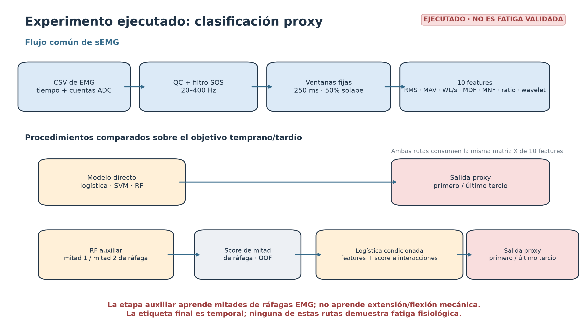
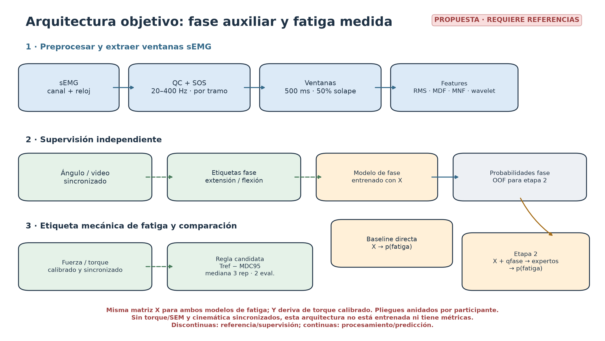
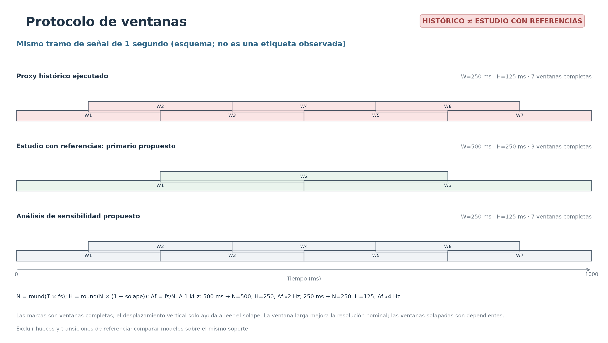
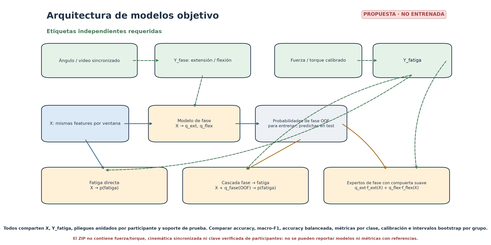
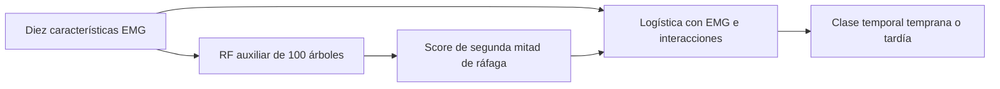

# Informe de evidencias del proyecto EMG

La entrega reconstruye una ruta reproducible desde los registros sEMG hasta las predicciones, compara seis procedimientos principales y prueba cinco variantes de una cascada auxiliar. En el ZIP original, la clase sigue siendo un proxy de posición temprana/tardía y el modelo no fue entrenado para distinguir fatiga de no fatiga. Una sección nueva documenta, por separado, un modelo binario por ventana supervisado con autoreportes sincronizados externos de fatiga percibida. Este documento permite distinguir ambas tareas, grupos, modelos y referencias.

**Actualización de objetivo, 2026-11-09:** el ZIP del curso contiene sEMG, bibliografía y tablas de filtros/QC, pero no referencias sincronizadas de torque/fuerza o cinemática. Por eso, sus métricas siguen correspondiendo a la etiqueta temporal temprana/tardía. Un experimento externo, separado y ejecutado, sí entrena un clasificador por ventana con autoreporte estable sincronizado de fatiga percibida; sus fórmulas, matrices y límites están en el [suplemento](FATIGUE_WINDOW_EXPERIMENT.md). La ventana externa de 500 ms no modifica retrospectivamente el pipeline histórico de 250 ms ni sus resultados congelados.

En la evaluación del corpus del curso, **la ventana es la observación** y las ventanas no son personas independientes. El modelo histórico no fue entrenado para distinguir fatiga de no fatiga; predice la posición temporal operativa de cada ventana.

La nueva búsqueda local quedó registrada en un recibo de auditoría privado. Los hashes del ZIP principal, del ZIP anidado y del RAR coinciden con los manifiestos originales; la inspección recuperó cero archivos con las referencias requeridas.

La matriz pública de auditoría en [REFERENCE_DATA_REQUIREMENTS.md](REFERENCE_DATA_REQUIREMENTS.md) detalla por referencia su presencia y ruta, unidades, resolución temporal, calibración, sincronización, nivel de etiqueta posible y límites. La columna `Voltage_mV` coincide con la conversión del exportador `round(ADC_Value × 3300 / 4095, 2)`; no demuestra calibración física. La matriz de [cumplimiento por requisito docente](PROFESSOR_REQUIREMENTS_COMPLIANCE_2026-11-09.csv) distingue trabajo verificado, implementaciones aún sin validación empírica y requisitos bloqueados por referencias ausentes.

El artículo revisado incluye fórmulas explícitas de filtros, ventanas, características, reglas candidatas de etiqueta y las tres arquitecturas propuestas. El [suplemento del experimento binario por ventana](FATIGUE_WINDOW_EXPERIMENT.md) añade la referencia estable de autoreporte, el detalle matemático del procesamiento, las matrices y la comparación de especialistas. Incluye además un diagnóstico privado de una señal real, el periodograma antes/después y la respuesta del filtro al `fs` medido.

## Corpus y señal

El ZIP principal contiene 140 CSV y 4.256.257 muestras. Las 138 grabaciones R1–R5 entran al procesamiento formal y dos R0 permanecen como controles. Hay 15 grupos derivados de carpetas. El reloj observado es aproximadamente de 1.000 Hz. Los archivos aportan tiempo relativo y cuentas ADC. La identidad individual, el modo eléctrico y la calibración física carecen de una referencia independiente.

El RAR adicional contiene 20 CSV de dos códigos y permanece separado. No se suma como dos personas verificadas ni como validación externa. El inventario, los hashes y las exclusiones se conservan para comprobar los denominadores. [Resultados y alcance del corpus](RESULTS.md), [diccionario](data_dictionary.md).

| Paso del procesamiento formal | Ventanas |
|---|---:|
| Candidatas | 33.090 |
| Calidad temporal válida | 32.474 |
| Actividad y características válidas | 9.289 |
| Etiqueta temprana o tardía elegible | 5.509 |

La referencia final contiene 2.329 ventanas tempranas y 3.180 tardías. Las ventanas no constituyen personas independientes.

## Preanálisis, procesamiento y etiquetas

El preanálisis cuantitativo revisa reloj, huecos, jitter, tramos constantes, repetición de extremos, prominencia de línea a 50/60 Hz y amplitud en cuentas ADC por tramo. Los resúmenes de amplitud no están calibrados a voltaje ni a fuerza muscular. Las trayectorias por repetición y fase no están disponibles porque el ZIP no aporta marcadores sincronizados y revisados. Se retiraron las curvas por deciles del tiempo: coinciden con la dimensión de la etiqueta proxy y no constituyen evidencia independiente de fatiga.

Los huecos mayores que el máximo de 1,5 ms y 1,5 veces el intervalo mediano separan tramos. El jitter relativo mayor a 5% invalida el tramo. Cada tramo válido se centra y filtra con Butterworth 20–400 Hz, prototipo de orden 4, aplicación bidireccional y exclusión de 100 ms por borde. La rama espectral conserva señal sin rectificar. El notch está desactivado en el principal.

La actividad candidata usa RMS de 50 ms, avance de 25 ms y umbral Otsu por registro. Las ventanas completas duran 250 ms, se solapan 50% y requieren ocupación activa de al menos 75%. Los tercios se calculan sobre los tiempos originales antes de las exclusiones: clase 0 en el primero y clase 1 en el último. Centro, fronteras, fallos de calidad y ausencia de actividad quedan fuera del contraste.

Las diez características son RMS, MAV, longitud de forma de onda por segundo, MDF, MNF, razón de potencia 20–60/60–400 Hz y cuatro energías relativas wavelet db4 A3/D3/D2/D1. Tiempo, identidad, pierna y serie no entran como predictores. [Contrato](protocol.md), [configuración](../configs/study.yaml), [preprocesamiento](../src/emg_fatigue/preprocessing.py), [características](../src/emg_fatigue/features.py).

El informe muestra el prototipo Butterworth análogo, el diseño digital SOS, la ecuación recursiva, la condición del notch según SciPy/Orfanidis, la ventana Hann y la escala de densidad del periodograma unilateral. El recibo privado incluye los SOS exactos por tramo y la huella de `filter_designs.json`; si la sensibilidad notch se activa, conserva sus coeficientes reales `b,a`, Q, ancho y diagnóstico. La longitud de forma de onda corregida v2 usa `(N−1)/fs` y queda versionada aparte; no modifica el resultado histórico. El protocolo prospectivo describe además las ecuaciones de etiquetas cinemáticas y por torque.

## Metodología y rendimiento principal

El pliegue externo de la validación cruzada retiene cada grupo completo una vez. Ambas piernas y todas las series permanecen juntas. Cuatro particiones agrupadas internas seleccionan parámetros usando macro-F1 medio por grupo. Escalador y modelo se ajustan sólo con entrenamiento. Las predicciones OOF y las búsquedas internas quedan guardadas. Los intervalos pareados usan bootstrap de los 15 grupos.

| Procedimiento | Macro-F1 media ± DE | AUC media |
|---|---:|---:|
| Mayoría | 0,3598 ± 0,0349 | 0,5000 |
| Logística RMS + MDF | 0,6272 ± 0,0980 | 0,7430 |
| Logística de diez características | 0,6355 ± 0,1262 | 0,8447 |
| SVM RBF | 0,6363 ± 0,1343 | 0,8039 |
| Random forest | 0,6366 ± 0,1259 | 0,8170 |
| Selector anidado | 0,6240 ± 0,1292 | 0,7984 |

El selector frente a RMS+MDF presenta diferencia media −0,0032 e IC 95% [−0,0591, +0,0509]. No hay ventaja clara del procedimiento complejo. Elegir retrospectivamente la mejor familia observada produciría una comparación distinta de la prespecificada. [Resultados principales](RESULTS.md), [modelo](MODEL_CARD.md).

Estos son resultados del proxy temprano/tardío y no métricas para fatiga/no fatiga. No se cambió la definición de clase ni se ajustaron parámetros para maximizar Accuracy o macro-F1 frente a una etiqueta no observada.

La matriz OOF del selector es `[[1473,856],[995,2185]]`, con filas de referencia y columnas de predicción. Los promedios por grupo se distinguen de métricas calculadas sobre esta matriz agrupada.

## Arquitectura auxiliar y relación entre modelos

La primera etapa aprende primera/segunda mitad de ráfagas EMG de 0,5–8 s. Usa RF de 100 árboles, profundidad 3 y mínimo 5 muestras por hoja. La referencia auxiliar contiene 3.337 ventanas, 1.663 primeras y 1.674 segundas mitades, de 996 ráfagas candidatas. La segunda etapa conserva los diez features y añade score y, en la variante principal, score×RMS/MDF/MNF. Sus scores de entrenamiento se obtienen fuera de muestra por grupo, repitiendo el procedimiento dentro de la selección interna.

El protocolo prospectivo compara tres modelos para un estudio con referencias: un baseline directo de fatiga `X → p(fatiga)`; una cascada `X + q_fase(OOF) → p(fatiga)`; y expertos de extensión/flexión combinados por probabilidades de fase. Todas las salidas usarían el mismo objetivo mecánico, pliegues externos y soporte. Esta arquitectura no está entrenada: el ZIP carece de torque/fuerza sincronizados, cinemática sincronizada y clave independiente de participantes.

El RF final principal tiene 300 árboles y es otro ajuste. El selector anidado elige una configuración, no combina votos. El directo suplementario `baseline_10` reproduce `logistic_all`; esta igualdad evita atribuir a la fase diferencias entre comparadores. [Arquitectura detallada](PHASE_EXPERIMENT.md), [registro de funciones](../results/phase_experiment/model_registry.csv), [fuente y protocolo original](../experiments/phase_proxy).

## Resultados auxiliares

| Variante de la segunda etapa | Macro-F1 media ± DE | AUC media |
|---|---:|---:|
| Directo de diez características | 0,6355 ± 0,1262 | 0,8447 |
| EMG + score | 0,6326 ± 0,1314 | 0,8422 |
| Condicionado por fase | 0,6293 ± 0,1330 | 0,8431 |
| Sólo score | 0,6184 ± 0,0801 | 0,7786 |
| Control aleatorio | 0,6356 ± 0,1139 | 0,8320 |

La diferencia de macro-F1 condicionada menos directa es −0,0062, IC 95% [−0,0232, +0,0082]. Mejoran 6 grupos, empeoran 8 y 1 empata. La diferencia pareada de Accuracy es −0,0051, IC 95% [−0,0222, +0,0095]. La cabeza auxiliar alcanza Accuracy 0,5775 ± 0,0783, macro-F1 0,5420 ± 0,1028 y AUC 0,6212 ± 0,1288 frente a mitades EMG. Su matriz es `[[970,693],[769,905]]`. La segunda etapa condicionada produce `[[1538,791],[1039,2141]]` frente al objetivo temprano/tardío. Ambas tareas siguen siendo proxy.

Se publican 12 filas de matrices por procedimiento/objetivo con conteos y proporciones. Una corresponde al directo que duplica la logística completa: no son doce modelos independientes. [Métricas](../results/phase_experiment/metrics_summary.csv), [contrastes](../results/phase_experiment/paired_differences.csv), [matrices](../results/phase_experiment/confusion_matrices.csv), [soporte auxiliar](../results/phase_experiment/auxiliary_phase_fold_metrics.csv).

## Comprobaciones que sostienen la entrega

| Objeto comprobado | Evidencia |
|---|---|
| Esquema, procesamiento, splits e inferencia | Pruebas del núcleo y recibos privados de procesamiento/evaluación/modelo |
| Soporte OOF, etiquetas, grupos disjuntos y normalización | Pruebas del suplemento, búsquedas, splits y auditoría de ajustes auxiliares |
| Identidad del comparador directo | Clases idénticas a `logistic_all`; máxima diferencia de score 5,1×10⁻¹³ |
| Reconstrucción auxiliar | 9.289 scores reconstruidos idénticos a los originales, diferencia máxima 0 |
| Conservación del modelo y originales | Hashes del modelo, cuatro insumos originales y entrega anterior |
| PDF/Word/PPTX y guiones | Recibo editorial, 30 diapositivas, 600 segundos principales y guiones español/inglés |
| Integridad completa del ZIP y del código | SHA256SUMS, manifiesto del snapshot Git y verificador portátil |
| Revisión publicada | Commit y CI exacta registrados en VERIFICACION_FINAL.json |

El verificador rechaza contenido modificado, faltante, adicional, nombres duplicados, rutas no portables y discrepancias entre el manifiesto del código y el del ZIP. Sus pruebas usan archivos sintéticos y no necesitan señales privadas. [Verificador](../tools/verify_delivery.py), [pruebas](../tests/test_delivery_integrity.py), [alcance de los checks](VERIFICATION.md).

Los resultados numéricos están congelados. Una revisión editorial posterior no se atribuye al commit que generó esos resultados. La entrega identifica por separado revisión numérica, fuente del artículo, fuente de la presentación y commit de publicación. El comprobante final se mantiene junto al ZIP para evitar una dependencia circular de su propio hash.

## Experimento complementario: fatiga percibida por ventana

Para responder a la observación central del docente, se ejecutó un modelo con ventanas EMG asignadas a etiquetas externas estables, sin construir la etiqueta a partir del inicio/fin del archivo ni de la propia señal. El objetivo es autoreporte de fatiga percibida (0 frente a 2); los estados de transición (1) y toda ventana que cruce el cambio se excluyen. El detector es por ventana, se evalúa con leave-one-participant-out y no recibe tiempo, identidad ni ensayo como feature.

La cohorte externa aporta 13 participantes, 156 ensayos y cuatro canales. Se retuvieron 125.165 ventanas de 500 ms y 50% de solapamiento. Cada canal pasa por Butterworth 20–450 Hz en SOS con aplicación hacia adelante/atrás. El espectro se calcula con periodograma unilateral Hann. Se calculan 15 features por canal (60 en total), con fórmulas de amplitud, longitud de onda, potencia, MDF/MNF, entropía y wavelets db4. La ecuación del filtro, la regla de alineamiento de etiqueta, el paso de ventana, el estimador espectral y cada feature están desarrollados en el [suplemento](FATIGUE_WINDOW_EXPERIMENT.md#filtro-ventana-y-espectro).

El HGB global alcanzó Accuracy/macro-F1 medios por participante de 0,656/0,630 (IC 95%: Accuracy 0,611–0,698; macro-F1 0,585–0,670). El control que recibe solo tiempo obtuvo 0,941/0,937 (0,911–0,966; 0,904–0,965). La diferencia pareada HGB−tiempo fue −0,285 en Accuracy (IC 95% −0,349 a −0,220) y −0,308 en macro-F1 (−0,370 a −0,248). Ningún modelo EMG superó ese control en alguno de los 13 participantes para estas métricas. Esto evidencia fuerte confusión temporal y rendimiento EMG insuficiente.

La búsqueda anidada obtuvo Accuracy/macro-F1 0,654/0,627; frente al HGB fijo las diferencias pareadas fueron −0,0019 (IC 95% −0,0076 a 0,0033) y −0,0029 (−0,0099 a 0,0032), sin mejora. Los expertos por músculo obtuvieron 0,639/0,612; frente al HGB fijo las diferencias fueron −0,0174 (−0,0267 a −0,0070) y −0,0177 (−0,0267 a −0,0075). Sus matrices, controles y parámetros por pliegue están en los CSV públicos; el [suplemento](FATIGUE_WINDOW_EXPERIMENT.md#rendimiento-del-detector-por-ventana) explica el enrutamiento por músculo y sus límites.

El experimento de Rossato et al. es adicional y usa una clase por ensayo completo (referencia frente a contracción TLim), no una clase por ventana. Su control temporal/estructura de ráfagas separa perfectamente los protocolos, lo que impide interpretar esa Accuracy como fatiga instantánea. Se mantiene aislado del detector por ventana.

## Interpretación final

El modelo del ZIP del curso continúa prediciendo una etiqueta proxy temporal; no predice fatiga. El experimento externo por ventana sí predice autoreporte estable de fatiga percibida, pero su rendimiento EMG es bajo frente al control temporal y no mide pérdida de fuerza. El benchmark separado de Rossato predice una etiqueta del ensayo completo y su control evidencia confusión de protocolo. Ninguno establece clasificación mecánica por ventana, movimiento verificado de extensión/flexión ni generalización clínica. Las referencias justifican estudiar fase de movimiento, pero no sustituyen etiquetas cinemáticas o fisiológicas independientes. [Bibliografía comentada](PHASE_REFERENCES.md).
