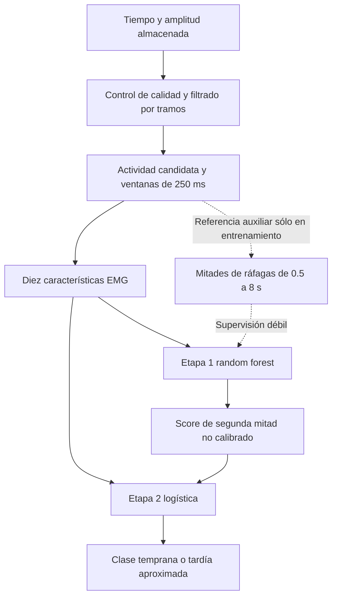
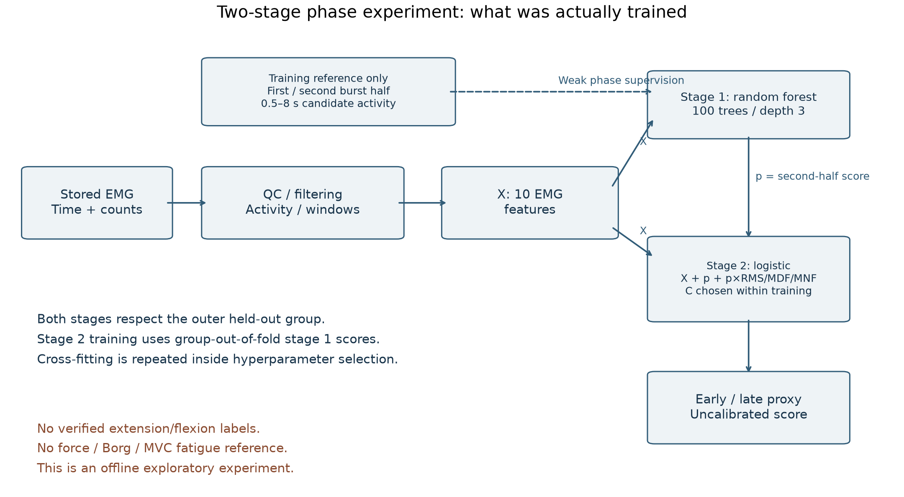
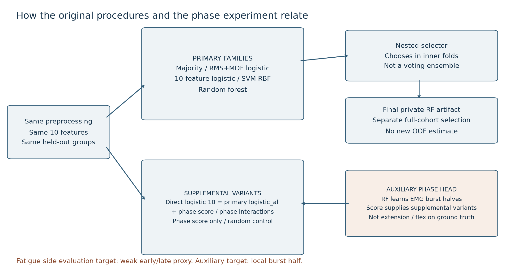
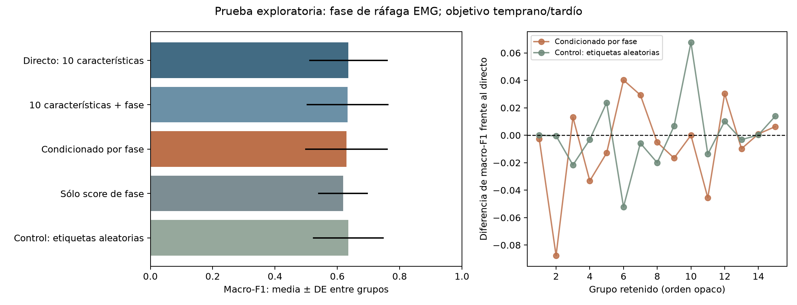
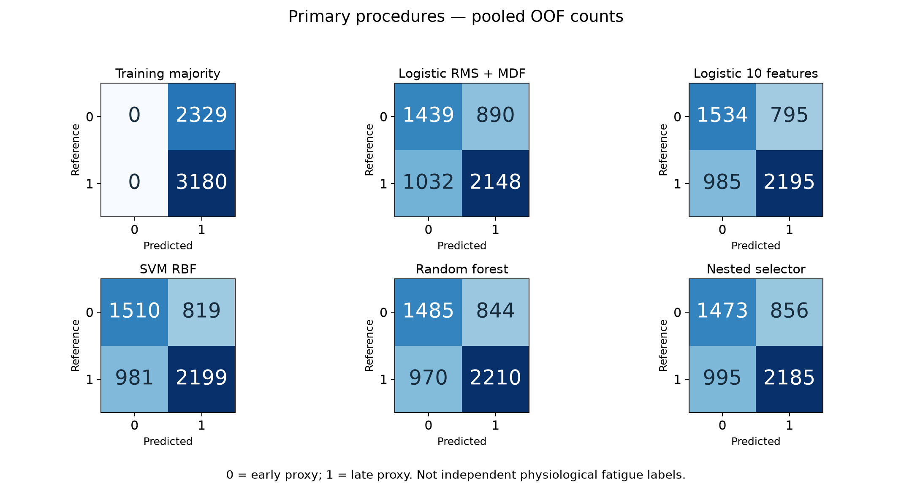
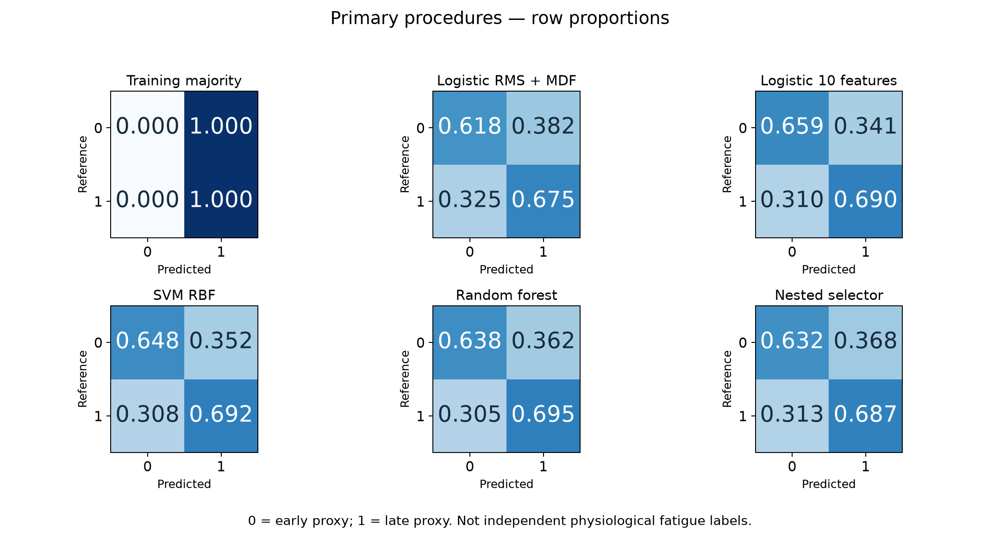
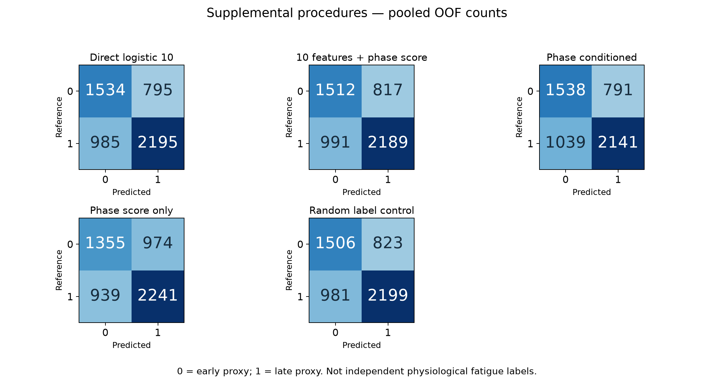
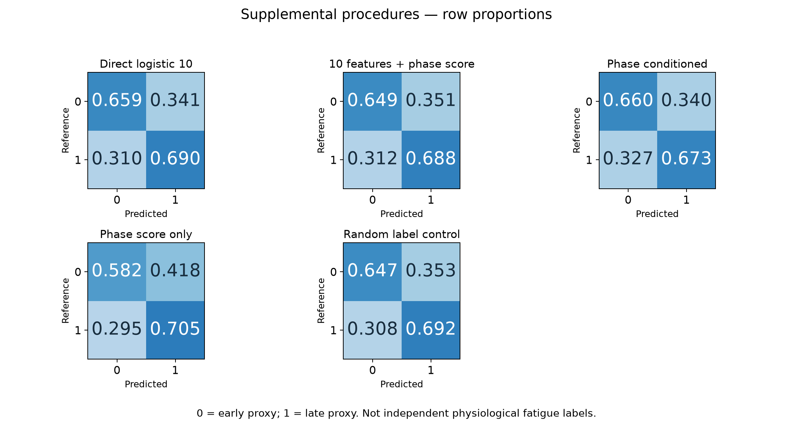
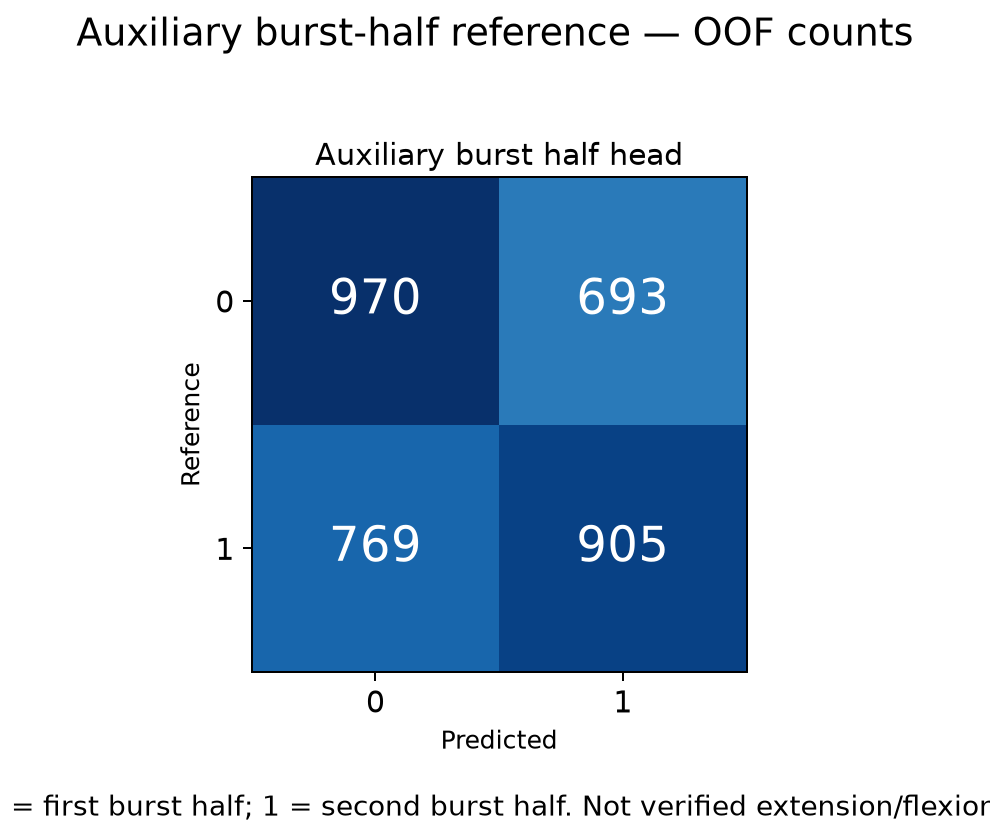
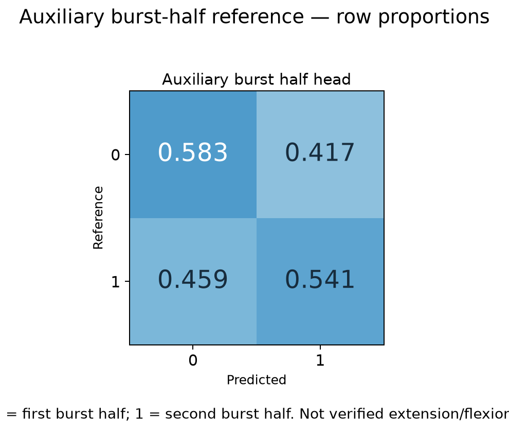

# Experimento suplementario de fase

**La variante de dos etapas no mostró una mejora clara.** El contraste principal, condicionado por fase menos logística directa de diez características, fue −0,0062 de macro-F1; IC bootstrap 95% [−0,0232; +0,0082]. Mejoró en seis grupos, empeoró en ocho y empató en uno. La entrega conserva el modelo principal; el experimento no lo reemplaza.

## Qué representan las dos etapas

La primera es un random forest que aprende primera/segunda mitad de ráfagas de actividad EMG. La segunda es una regresión logística que recibe las diez características EMG y el score de la primera. La variante principal añade interacciones del score con RMS, MDF y MNF. **La primera etapa no es un detector validado de extensión/flexión. La segunda no tiene etiquetas fisiológicas independientes de fatiga.** Su objetivo es la misma aproximación temprano/tardío del estudio principal.

## Relación entre todos los procedimientos

| Familia o procedimiento | Entradas y función | Relación con los otros |
|---|---|---|
| Mayoría de entrenamiento | Prior de clase | Referencia mínima |
| Logística RMS+MDF | Dos características | Referencia simple requerida |
| Logística completa | Diez características | Mismas predicciones que `baseline_10` del suplemento |
| SVM RBF | Diez características | Familia no lineal principal |
| Random forest principal | Diez características | Familia principal con selección interna de profundidad y hoja |
| Selector anidado | Selecciona familia y parámetros dentro del entrenamiento | Procedimiento de selección, no votación entre modelos |
| `phase_score` | Diez características + score auxiliar | Cascada sin interacciones |
| `phase_conditioned` | Diez características + score + score×RMS/MDF/MNF | Variante suplementaria principal |
| `phase_only` | Sólo score auxiliar | Diagnóstico del cuello de botella |
| `random_conditioned` | Misma arquitectura condicionada con etiquetas auxiliares aleatorias | Control de complejidad; una sola realización |
| Cabeza auxiliar de fase | Diez características → mitad de ráfaga | Objetivo distinto; 3.337 ventanas de referencia |
| Artefacto RF final privado | Repite la selección interna con toda la cohorte | Modelo serializado; no aporta otra estimación OOF |

El RF auxiliar de fase tiene 100 árboles, profundidad 3 y hoja mínima 5. El RF final principal tiene 300 árboles, profundidad 3 y hoja mínima 2. Son ajustes distintos, con objetivos y funciones distintos. El hecho de compartir familia no los hace el mismo modelo.

## Protocolo y prevención de contaminación

El [protocolo original](../experiments/phase_proxy/PROTOCOLO_ANTES_DE_RESULTADOS.md) se conserva con su hash anterior a los resultados. Se detectaron 996 ráfagas candidatas, con 1.663 ventanas de primera mitad y 1.674 de segunda mitad. Las ventanas que cruzan centro o extremos no reciben referencia auxiliar. Su ausencia no elimina ventanas de la comparación de fatiga: todas las variantes conservan exactamente las mismas 5.509 ventanas y 15 grupos del estudio principal.

La cabeza auxiliar usa sólo las diez características originales; no recibe tiempo, ID, posición de ráfaga ni etiqueta temprano/tardío. La referencia auxiliar sí depende de la segmentación EMG, por lo que no constituye cinemática independiente. Se usa el tercio central para aprender fase sólo cuando pertenece a grupos de entrenamiento.

En cada partición externa, los otros 14 grupos producen scores auxiliares mediante cross-fitting agrupado para entrenar la segunda etapa. Dentro de cada partición interna se repite ese procedimiento sin tocar los grupos de validación. Cuatro particiones internas seleccionan C=0,1/1/10. Se comprobaron 645 solicitudes con grupos disjuntos y 278 ajustes auxiliares únicos reutilizados por clave de grupos y objetivo. No se afinó el experimento con las puntuaciones externas.

El baseline reprodujo exactamente las clases de `logistic_all`, con diferencia máxima de score de 5,10×10⁻¹³. Se guardaron 75 filas modelo×grupo y 27.545 predicciones OOF de la segunda etapa. Las predicciones auxiliares reconstruidas reprodujeron sus métricas por grupo.

## Resultados

| Variante | Macro-F1 media ± DE | ROC-AUC media ± DE |
|---|---:|---:|
| Directo de diez características | 0,6355 ± 0,1262 | 0,8447 ± 0,0746 |
| Diez características más score de fase | 0,6326 ± 0,1314 | 0,8422 ± 0,0732 |
| Condicionado por fase | 0,6293 ± 0,1330 | 0,8431 ± 0,0741 |
| Sólo score de fase | 0,6184 ± 0,0801 | 0,7786 ± 0,0768 |
| Control aleatorio condicionado | 0,6356 ± 0,1139 | 0,8320 ± 0,0706 |

La primera etapa obtuvo macro-F1 0,5420 ± 0,1028 y AUC 0,6212 ± 0,1288 frente a mitades EMG. Este resultado no valida extensión/flexión. La arquitectura usa resúmenes por ventana, no un modelo secuencial con contexto temporal.

El selector principal obtuvo 0,6240, pero es un procedimiento diferente. Comparar 0,6293 directamente con él no aísla el aporte de fase. La comparación principal apropiada es contra `baseline_10`, equivalente a la logística completa original. El intervalo pareado cruza cero y la variante de fase tampoco supera el control de etiquetas aleatorias. Son comparaciones exploratorias de esta cohorte pequeña, no una confirmación poblacional de equivalencia o de perjuicio.

## Matrices de confusión y denominadores

Cada matriz se calcula desde predicciones OOF. Filas = referencia; columnas = predicción. En las matrices temprano/tardío, cada procedimiento tiene soporte 2.329/3.180, total 5.509. La cabeza auxiliar tiene soporte 1.663/1.674, total 3.337. No deben confundirse los dos vocabularios ni sumarse las ventanas entre procedimientos como personas independientes. Los porcentajes se normalizan por fila; las matrices agrupadas muestran conteos, no incertidumbre entre personas.

### Seis procedimientos principales

### Cinco variantes suplementarias

### Primera etapa auxiliar

Las matrices y soportes exactos están en [confusion_matrices.csv](../results/phase_experiment/confusion_matrices.csv). Las medias, DE e intervalos están en [metrics_summary.csv](../results/phase_experiment/metrics_summary.csv); los contrastes pareados en [paired_differences.csv](../results/phase_experiment/paired_differences.csv). Los identificadores de partición publicados son opacos y reutilizan el mismo mapeo privado del estudio principal.

## Bibliografía y reproducibilidad

La [bibliografía comentada](PHASE_REFERENCES.md) distingue fundamento biomecánico, estudios con IMU y sistemas de reconocimiento combinado. Cheah et al. (2022) es el antecedente más cercano, con fase cinemática medida; no equivale a nuestro experimento ni demuestra su superioridad. Ningún resultado externo se presenta como validación local.

El [código original del experimento](../experiments/phase_proxy/phase_spike.py), el [exportador de evidencia](../experiments/phase_proxy/evidence.py) y las [pruebas de integridad](../tests/test_phase_evidence.py) están publicados. La entrega privada conserva fuente, características, OOF, predicciones auxiliares, búsquedas, particiones y recibos. No se publican datos individuales ni el modelo privado. El informe y las diapositivas incluyen los mismos resultados y arquitectura.
