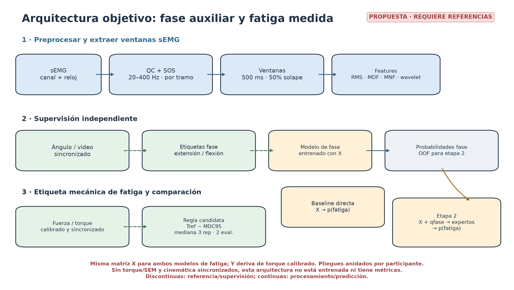
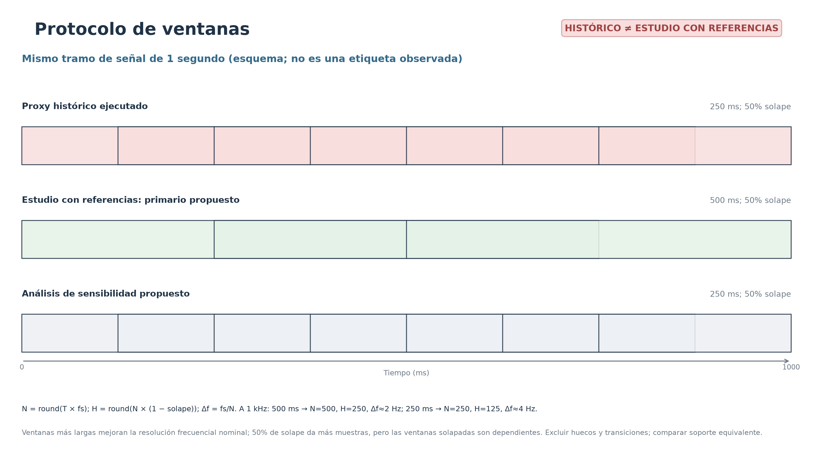
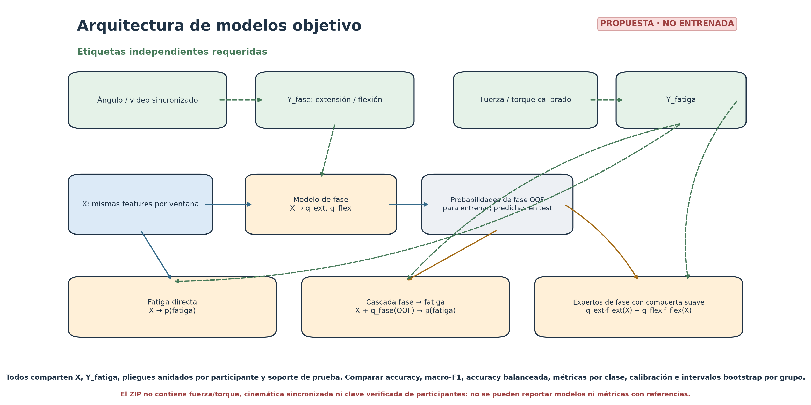

# Protocolo para fatiga y fase con referencias independientes

**Estado:** protocolo prospectivo; no entrenado con datos experimentales. Gate G0 falló porque el ZIP disponible aporta sEMG, pero no torque/fuerza calibrados y sincronizados, cinemática sincronizada ni identidad de participantes verificada. La implementación histórica sigue descrita en [protocol.md](protocol.md) y continúa siendo una clasificación proxy temporal.

## Objetivos y variable objetivo

1. **Fase:** entrenar extensión/flexión desde características sEMG, con etiquetas obtenidas de ángulo de rodilla o video/kinemática revisados y sincronizados. Excluir inversiones y transiciones según una banda muerta derivada de resolución/ruido y una convención angular registrada.
2. **Fatiga:** entrenar fatiga/no fatiga desde sEMG con etiquetas mecánicas independientes de torque/fuerza, calibradas y sincronizadas. Borg y MVC pre/post pueden ser resultados secundarios de sesión, pero no son automáticamente una etiqueta por ventana.
3. **Predicción:** comparar un modelo directo `EMG → fatiga`, una cascada `EMG → fase → fatiga` y especialistas de fatiga por fase. La cascada es una hipótesis; su mejora se debe medir en los mismos participantes y pliegues externos.

La ventana es una observación. No es la clase objetivo. No se utiliza el tercio temprano/tardío de la grabación para construir etiquetas fisiológicas ni las mitades de ráfagas EMG para nombrar extensión/flexión.

## Preprocesamiento y ventana

- Antes de filtrar, verificar reloj, fs efectiva, huecos, jitter, saturación, ruido de red, modo de medición, ancho de banda del sensor y calibración. No interpolar huecos largos ni filtrar a través de ellos.
- Centrar cada tramo continuo. Mantener el pasa banda 20–400 Hz solo si la respuesta del sensor y Nyquist lo permiten. Calcular coeficientes por cada `fs` validada. El protocolo histórico lo implementa con Butterworth `n=4` en SOS y `sosfiltfilt`; al ser bidireccional es análisis offline. Enmascarar 100 ms por extremo.
- Activar notch 50/60 Hz solo si un diagnóstico PSD de los datos muestra prominencia según el criterio predeclarado. No asumir que la frecuencia de red contamina todos los registros. Normalizar a `%MVC` solo con MVC válida, calibrada y comparable.
- **Principal:** ventana deslizante fija `T=0,5 s`, solapamiento `ρ=0,5`. Para cada tramo se calcula `N=round(T·fs)` y `H=round(N·(1−ρ))`; a 1 kHz, `N=500` muestras y `H=250`.
- **Sensibilidad:** `T=0,25 s`, `H=125` y `N=250` a 1 kHz. Reportar aparte; no sustituye silenciosamente la principal ni se compara con resultados históricos como si fuese el mismo experimento.
- El espaciamiento nominal del DFT es `Δf=fs/N`: a 1 kHz, 2 Hz para 500 ms y 4 Hz para 250 ms. `Δf` no equivale a resolución espectral efectiva: Hann ensancha el lóbulo principal. El solapamiento genera observaciones dependientes y no aumenta el número de sujetos.
- Los índices son `x_i[n]=x[iH+n]`, `n=0,…,N−1`. No completar fases cortas con ceros. Una ventana que atraviese hueco de adquisición, transición/inversión o inicio de fatiga se marca inválida o sin etiqueta; no se fuerza a clase 0.

## Filtro y ecuaciones

El prototipo analógico Butterworth pasa-bajos de orden `n` tiene magnitud cuadrática

`|H_a(jΩ)|² = 1 / (1 + (Ω/Ω_c)^(2n))`.

Esto describe solo el prototipo analógico; **no** es por sí mismo el filtro digital del análisis. La implementación diseña el pasa banda digital como `butter(n=4, Wn=[20, 400], btype='bandpass', fs=fs, output='sos')`. Para pasa banda, el orden digital final es `2n=8`. La respuesta SOS digital es

`H(z) = ∏_r (b0,r + b1,r z⁻¹ + b2,r z⁻²) / (a0,r + a1,r z⁻¹ + a2,r z⁻²)`.

Cada sección recursiva cumple

`y_r[n] = (b0,r x_r[n] + b1,r x_r[n−1] + b2,r x_r[n−2] − a1,r y_r[n−1] − a2,r y_r[n−2]) / a0,r`.

Los coeficientes se recalculan para cada tasa `fs` verificada y se almacenan en el recibo; no hay un conjunto universal. `sosfiltfilt` aplica el filtro hacia adelante y hacia atrás, con fase cero y orden efectivo duplicado; no corresponde a una aplicación causal en línea. Enmascarar 100 ms por extremo limita el efecto de borde, pero no lo elimina matemáticamente.

Si se activa notch, se diseña el IIR de segundo orden con `b,a = iirnotch(f0, Q=30, fs=fs)` y `Q=f0/BW`, donde `BW` es el ancho de −3 dB. El biquad utiliza la misma ecuación recursiva anterior. La activación, frecuencia, coeficientes y evidencia de prominencia se guardan por tramo.

## Ventana Hann y periodograma

La ventana de análisis es

`w[n] = 0,5·(1−cos(2πn/(N−1)))`, para `0≤n<N`.

Para la señal centrada `x[n]`, `X_w[k]=Σ_n x[n]w[n]e^(−j2πkn/N)`. El periodograma unilateral de densidad de potencia es

`Pxx[k] = c_k·|X_w[k]|² / (fs·Σ_n w[n]²)`,

con `c_k=2` en bins positivos interiores y `c_k=1` en DC y Nyquist cuando existe. El código usa `scipy.signal.periodogram(window='hann', detrend=False, scaling='density')` después de centrar la ventana. La implementación histórica usa periodograma Hann, **no Welch**. Hann reduce fuga por las discontinuidades entre ventanas, con mayor anchura espectral. `Δf=fs/N` indica separación de bins, no garantiza resolver dos tonos separados exactamente por ese valor.

## Características y fórmulas

Para `N` muestras centradas `x[n]` en cuentas ADC, tasa `fs` en Hz, bins `f[k]` y PSD `Pxx[k]` dentro de la banda analizada:

| Feature | Fórmula | Interpretación y unidades |
|---|---|---|
| RMS | `sqrt((1/N) Σ_{n=0}^{N−1} x[n]²)` | Amplitud eficaz; cuentas ADC. También cambia con esfuerzo, reclutamiento, colocación y ganancia. |
| MAV | `(1/N) Σ_{n=0}^{N−1} |x[n]|` | Amplitud absoluta media; cuentas ADC. |
| Longitud de forma de onda/s, esquema histórico v1 | `(fs/N) Σ_{n=1}^{N−1}|x[n]−x[n−1]|` | Variación absoluta por segundo; cuentas ADC/s; divisor histórico `N/fs`. |
| Longitud de forma de onda/s, esquema corregido v2 | `Σ_{n=1}^{N−1}|x[n]−x[n−1]| / ((N−1)/fs)` | Variación por el lapso entre primera y última muestra; cuentas ADC/s. Nombre propio `waveform_length_per_s_sample_span`; no sustituye v1. |
| MDF | `min f_m : Σ_{f_k≤f_m}Pxx[k] ≥ 0,5·Σ_kPxx[k]` | Frecuencia mediana de potencia dentro de la banda; Hz. |
| MNF | `Σ_k f[k]Pxx[k] / Σ_kPxx[k]` | Media ponderada por potencia; Hz. |
| Razón de potencia | `Σ_{20≤f_k<60}Pxx[k] / Σ_{60≤f_k≤400}Pxx[k]` | Forma relativa del espectro; adimensional. Rechazar si el denominador es cero o la energía no basta. |
| Energía wavelet relativa | `E_j=Σ_m c_j[m]² / Σ_{q∈{A3,D3,D2,D1}}Σ_m c_q[m]²` | DWT db4, nivel 3, extensión simétrica; adimensional. Rechazar si la energía total es cero. |

El esquema histórico `emg_window_features_v1` permanece congelado. `emg_window_features_v2_sample_span` aplica el lapso `(N−1)/fs` y debe llevar recibo/modelo independiente; las matrices y resultados v1 no se regeneran con la fórmula nueva. Una feature adicional requiere etiquetas de referencia antes de atribuirle valor predictivo.

## Etiquetas y aprobación del protocolo

El código de etiqueta exige fuente, unidad, calibración, eje temporal de referencia y EMG, residuo de sincronización dentro de tolerancia, claves de participante/sesión, nivel de referencia y versión/aprobación de definición. La regla torque/MDC95/persistencia sigue siendo candidata hasta que un revisor de biomecánica confirme instrumento, repetibilidad, baseline, rango angular, inicio y exclusiones. Solo se puede ejecutar en fixtures sintéticos marcados `synthetic_only`; estos resultados no se exportan como evidencia experimental.

Para el ángulo, el convenio debe declararse explícitamente como `flexion_positive` o `extension_positive`. `ω(t)=dθ/dt`; una vez expresado el ángulo en convenio de flexión positiva, `ω>δ` etiqueta flexión, `ω<−δ` extensión y `|ω|≤δ` transición. `δ` debe estimarse con resolución/ruido del sensor. No hay convenio ni `δ` congelados para el corpus actual, pues no incluye kinemática.

Antes de entrenar, graficar RMS, MAV, MDF, MNF y razón espectral por repetición y fase verificada. Si no existen esos marcadores, ese preanálisis es no disponible; no sustituirlos con tercios temporales.

## Modelos y validación

- **Directo:** logística RMS+MDF, logística con features predefinidas, SVM-RBF y Random Forest contra etiquetas mecánicas aprobadas.
- **Fase:** clasificador sEMG → extensión/flexión contra etiqueta cinemática aprobada.
- **Cascada:** segundo modelo usa features EMG más probabilidades de fase out-of-fold durante entrenamiento y probabilidades predichas desde datos de entrenamiento al evaluar; nunca recibe la fase verdadera del pliegue de prueba.
- **Especialistas:** expertos de fatiga por fase combinados mediante `p_expert = q_ext·f_ext(X)+q_flex·f_flex(X)`; `q_ext` y `q_flex` son probabilidades predichas.
- Probabilidades: `p_direct=σ(β₀+βᵀX)`, `p_cascade=σ(a₀+aᵀX+η_ext·q_ext+η_flex·q_flex)` y `σ(z)=1/(1+e^(−z))`. Los parámetros se ajustan solo dentro de pliegues de entrenamiento.
- Mantener participantes completos (sesiones, lados y series) dentro de un solo pliegue externo. Ajustar estandarización, selección, calibración y umbrales solo en pliegues internos; calcular probabilidades de fase OOF para el entrenamiento de la segunda etapa.
- Reportar Accuracy, macro-F1, balanced accuracy, precisión/recall/F1 por clase, sensibilidad, especificidad, ROC-AUC, PR-AUC, calibración y matrices de confusión con conteo y normalización. Incertidumbre y comparaciones pareadas se calculan por participante, no por ventana solapada.
- Declarar mejora solo si Accuracy y macro-F1 superan al modelo directo en los mismos participantes y los contrastes pareados por participante respaldan la diferencia. No cambiar etiquetas, particiones ni umbrales después de ver el pliegue externo.
- Fine-tuning solo con fuente externa compatible y plan fijo; RL no aplica a clasificación supervisada estática sin acciones/recompensas secuenciales.

## Gate G0 y fuentes técnicas

No ejecutar clasificación supervisada real hasta que haya torque/fuerza calibrado y sincronizado, repetibilidad/SEM, referencia temporal, claves seudónimas verificables y aprobación escrita de la definición. La arquitectura fase-condicionada requiere además ángulo/video sincronizado. Si solo hay sEMG, esta especificación y sus diagramas son propuesta, no resultado.

- [SciPy `butter`](https://docs.scipy.org/doc/scipy/reference/generated/scipy.signal.butter.html): diseño y orden de filtros SOS.
- [SciPy `sosfiltfilt`](https://docs.scipy.org/doc/scipy/reference/generated/scipy.signal.sosfiltfilt.html), [`filtfilt`](https://docs.scipy.org/doc/scipy/reference/generated/scipy.signal.filtfilt.html), [`periodogram`](https://docs.scipy.org/doc/scipy/reference/generated/scipy.signal.periodogram.html), [ventana Hann](https://docs.scipy.org/doc/scipy/reference/generated/scipy.signal.windows.hann.html) y [`iirnotch`](https://docs.scipy.org/doc/scipy/reference/generated/scipy.signal.iirnotch.html): definiciones computacionales del procesamiento.
- Gerdle, Larsson y Karlsson, [criterion validation using peak torque during repeated knee extensions](https://pubmed.ncbi.nlm.nih.gov/10969195/): ejemplo de evaluación de variables sEMG contra un criterio biomecánico independiente por contracción; no determina automáticamente la regla de este protocolo.
- [Analysis and biophysics of surface EMG](https://pmc.ncbi.nlm.nih.gov/articles/PMC7594523/): contexto para interpretar la amplitud y el espectro junto con factores de contracción y adquisición.
