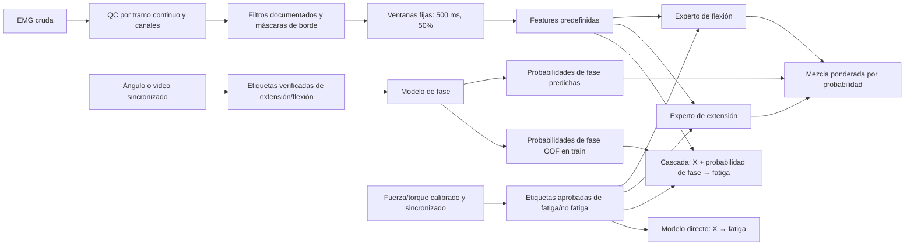

# Corrección del objetivo de fatiga y fase — Implementation Plan

> **For agentic workers:** Use `superpowers:executing-plans` to implement this plan task by task. Steps use checkbox (`- [ ]`) syntax for tracking.

**Goal:** Rebuild and evaluate the main experiment so the fatigue classifier is trained against an independent, time-aligned force/torque reference, and the optional first stage predicts extension/flexion from kinematics before fatigue inference.

**Architecture:** Keep the existing early/late-window and EMG-burst-half results as historical proxy experiments. Build a separate reference-backed pipeline: quality-controlled sEMG → phase-contained windows and documented features → (a) direct fatigue classifier and (b) an auxiliary phase classifier whose out-of-fold phase probabilities condition a fatigue classifier or phase-specific experts. Compare these under participant-disjoint validation; do not feed true test-phase labels to the second stage.

**Tech Stack:** Existing Python 3.12 project, NumPy, SciPy, pandas, scikit-learn, PyWavelets, matplotlib, pytest, existing manuscript and slide builders, LibreOffice/Poppler for rendering.

**Spec:** Professor feedback in the current conversation; source requirements in `C:/Users/Pc/Desktop/BIOMECANICA/MIDDDLE PART/audit_emg_2026-10-28/PLAN_AUDITABLE_EMG.md`; existing scientific contract in `docs/protocol.md`, `docs/PHASE_EXPERIMENT.md`, and `docs/PHASE_REFERENCES.md`.

**Status key:** `[x]` means implemented or audited and verified for its stated scope. `[ ]` means incomplete or blocked; consult the execution record below. Gate G0 is a real-data requirement, not a software-test substitute.

## Resolved design discrepancies

- **What the present classifier learns:** it predicts early-versus-late recording-position labels assigned to feature windows. It is not trained against independent muscle-fatigue labels, and its scores do not establish fatigue detection. The auxiliary experiment predicts first-versus-second halves of EMG bursts, not extension versus flexion. Preserve both only as historical proxy results.
- **Window protocol:** retain the frozen 250 ms, 50% overlap configuration for exact reproduction of the existing proxy. The new reference-backed fatigue/phase study uses a separate configuration: 500 ms, 50% overlap as primary and 250 ms as a pre-specified sensitivity analysis. At a verified 1 kHz, these correspond to 2 Hz and 4 Hz nominal spectral-bin spacing. Do not compare their scores as if they were the same experiment.
- **Fatigue threshold:** `T_ref`, `MDC95 = 1.96 × sqrt(2) × SEM`, and the rolling three-repetition/two-confirmation rule are a candidate operational rule only. A biomechanics reviewer must confirm the torque definition, matched-angle region, repeatability source, exclusions, and onset timing before labels are frozen. No labels or fatigue training are permitted before that sign-off and Gate G0.
- **Metric goal:** higher Accuracy and macro-F1 are evaluation goals, not promised outcomes. Compare the direct and auxiliary architectures on the same participant-held-out folds and labels; report no demonstrated gain when paired participant-level uncertainty does not support it.
- **PSD estimator:** the executed implementation uses a one-sided Hann periodogram, not Welch averaging. Preserve this historical estimator. Use Welch only as a separately specified method if its segment length, overlap, detrending, scaling and averaging are fixed before evaluation.
- **Waveform length:** the historical feature divides total adjacent absolute change by `N/fs`. A corrected feature schema will use the sample-span duration `(N−1)/fs`, give it a distinct name and receipt, and leave historical feature files and results unchanged. These definitions are not equivalent.
- **Filter mathematics:** distinguish the analog Butterworth low-pass prototype magnitude relation from the implemented digital band-pass. Report the actual SOS transfer function and coefficients generated for each verified `fs`; do not present one coefficient set as universal.
- **Reference level:** distinguish session-level MVC/Borg, repetition-level force/torque, and window-level aligned labels. Do not expand session scores into window labels without a validated protocol.

## Global Constraints

- Do not call elapsed-time thirds “fatigue” ground truth. The current early/late labels remain a weak proxy and must not be mixed with reference-backed results.
- Do not call EMG burst-half prediction extension/flexion. Movement phase needs synchronized angle or reviewed video/kinematic markers.
- Fatigue supervision requires calibrated, synchronized mechanical output (force/torque) and a pre-specified fatigue-onset threshold tied to the protocol and measurement repeatability. Borg or 1RM alone is not a window-level fatigue reference.
- Preserve the supplied ZIP, original report, old delivery ZIP and current historical results. Work in a versioned private output; keep raw recordings, calibration records, identity mapping and granular predictions out of public GitHub.
- Keep the course cohort and protocol as the primary study. Any new cohort requires separate authorization and analysis; do not silently substitute it for the course cohort.
- Split by verified participant (and preserve sessions together where applicable); windows from one person must never cross training and test folds.
- Do not promise higher Accuracy/F1 before the reference-backed experiment runs. Choose thresholds and models only inside training folds; use outer held-out groups for the final comparisons.
- Keep the primary direct-fatigue model and the auxiliary phase-conditioned architecture as distinct, comparable procedures. No reinforcement-learning experiment is in scope for this offline labeled-classification objective.
- Strict reference-label/window contracts, formula documentation and diagrams have been implemented as gated protocol tooling. They do not validate labels or create a physiological training set. The historical proxy outputs remain frozen.

## Respuesta al último comentario del docente — plan de corrección

**Corrección del objetivo:** la ventana de 250/500 ms es la unidad de observación; no es la clase que aprende el modelo. Cada ventana solo recibe `fatiga` o `no fatiga` si una referencia mecánica independiente, calibrada, sincronizada y aprobada permite derivar ese estado. Las etiquetas temprana/tardía actuales quedan identificadas como proxy histórico. Del mismo modo, una etapa auxiliar solo se llamará extensión/flexión cuando la fase venga de cinemática o video revisado y sincronizado.

**Ruta del modelo prevista:**

Las ventanas que crucen un hueco, transición de fase o inicio de fatiga se excluyen o quedan explícitamente inciertas; nunca se convierten automáticamente en `no fatiga`. En la cascada, la segunda etapa se entrena con probabilidades de fase fuera de pliegue y en prueba recibe probabilidades predichas para participantes no vistos. Los expertos se enrutan suavemente con esas probabilidades; la fase verdadera del pliegue de prueba no se usa para predecir.

| Fase | Acción y aceptación auditable | Estado con el ZIP disponible |
|---|---|---|
| 1. Corregir la interpretación | Conservar matrices y métricas históricas con el nombre de proxy temprano/tardío; señalar expresamente que no son métricas de fatiga fisiológica ni de extensión/flexión. | Implementado en protocolo y respuesta al docente; verificar consistencia en cada artefacto final. |
| 2. Preparar una señal defendible | Auditar fs real, gaps, jitter, clipping, línea eléctrica y máscaras por tramo; documentar filtro SOS 20–400 Hz, notch solo si la prominencia medida lo justifica, borde de 100 ms, ventana y cada feature con fórmula/unidades. Mantener el estudio nuevo en 500 ms/50% y sensibilidad de 250 ms separado del proxy histórico de 250 ms. | Contratos y parte de las pruebas están implementados; completar casos de señal y revisar renderización/equaciones. |
| 3. Cerrar las etiquetas | Fatiga desde fuerza/torque aprobado; fase desde ángulo/video sincronizado; confirmar calibración, alineación, repetibilidad, límites y claves de grupo antes de exportar etiquetas. | **Bloqueado por datos:** el ZIP no contiene estas referencias. No crear etiquetas reales ni entrenar con los proxies. |
| 4. Comparar arquitecturas | En el mismo soporte y particiones por grupo: baseline directo, clasificador de fase, cascada OOF y expertos por fase con mezcla probabilística. Mantener logística interpretable y RMS+MDF como baselines; comparar SVM/RF como candidatos. | Evaluador fail-closed y pruebas sintéticas implementados; ejecución empírica bloqueada por Gate G0. |
| 5. Medir rendimiento | Accuracy, macro-F1, balanced accuracy, sensibilidad/especificidad, precisión/recall/F1 por clase, ROC/PR-AUC y matrices de confusión con conteos y normalización; IC y diferencias pareadas por participante/grupo. Declarar mejora solo si Accuracy y macro-F1 mejoran en idéntico soporte y la incertidumbre pareada lo respalda. | No hay métricas de fatiga real calculables con este ZIP. No se garantiza subirlas manipulando ventanas, etiquetas o pliegues. |
| 6. Presentar y entregar | Redibujar diagramas de señal y arquitecturas con etiquetas de estado (ejecutado/propuesto/bloqueado); integrar corpus, preanálisis cuantitativo, filtros, ventana, fórmulas, modelos, métricas proxy y límites; actualizar README, informe, guion, paquete ZIP y manifiestos. | Algunos documentos/figuras ya cubren esta estructura; cerrar contra una sola tabla de claims y hashes después de la revisión visual final. |

**Elección metodológica:** no usar reinforcement learning para clasificación supervisada de ventanas: aquí no existen acciones ni recompensas secuenciales. No hacer fine-tuning de una red como atajo para subir métricas: solo reconsiderarlo si aparece una fuente externa etiquetada compatible, independiente y con un plan de transferencia fijado antes de abrir el holdout. Las cabezas especialistas sí se comparan como modelo supervisado y solo si cada fase contiene ambos estados de fatiga en suficientes grupos.

**Límite de rendimiento:** el trabajo de señal y de software puede mejorar errores técnicos y hacer que una comparación futura sea válida; no puede demostrar mayor Accuracy/F1 de fatiga sin la etiqueta independiente. El umbral `G0` sigue siendo obligatorio para el entrenamiento fisiológico; datos sintéticos prueban contratos, no rendimiento experimental.

## Review Focus

- **Label validity:** no independent force/torque reference or no calibration/repeatability data → refuse to create fatigue labels; test missing, invalid and unsynchronized references.
- **Phase validity:** no joint-angle/video reference → do not name a burst-half result extension/flexion; test direction, transition deadband, clock alignment and angle-convention handling.
- **Window boundary leakage:** windows may overlap fatigue onset or phase transitions → mark uncertain/cross-boundary windows and exclude or explicitly model them; test exact boundary behavior.
- **Participant leakage:** recordings may have filename-derived identities → verify the mapping and assert zero group overlap in nested folds and phase-score generation.
- **Metric inflation:** selecting features, thresholds or model families on outer folds inflates results → test that all tuning/calibration is nested and report per-group uncertainty alongside pooled counts.

---

### Task 0: Freeze protocol, inventory references, and apply the data gate

**Files:** `docs/protocol.md`, `docs/data_dictionary.md`, `docs/EXECUTION_LEDGER.md`, private audit outputs only.

**Interfaces:** Consume the supplied ZIP, the embedded course guidance and the existing private audit. Produce an immutable inventory with SHA-256, source path, modality, units, timestamps, calibration state, participant/session key, synchronization evidence and privacy classification.

- [x] Re-audit the supplied archive and the already inventoried embedded ZIP/RAR for expected MVC, Borg CR-10, anonymized participant metadata, synchronized video/kinematics, repetition markers, calibration files and time-series force/torque. Record found, absent, unreadable and ambiguous separately; do not contact anyone or start a new cohort as part of this audit. Receipt: private `audit_emg_2026-10-28/reference_data_recovery_2026-11-09.json`.
- [x] Create a private source-to-recording crosswalk. Do not infer independent subjects by adding filename codes from different archives. Receipt: private 160-row crosswalk; identity and cross-archive links remain unverified.
- [x] Implement a reference-label contract that records reference level (`session`, `repetition`, or `window`), source IDs, units, calibration, time axis, synchronization, participant/session keys, and approval/version of the fatigue definition. It abstains on missing or invalid references. The torque/MDC95/persistence rule remains a candidate until a biomechanics reviewer approves its measurement precision, baseline, matched-angle region, onset, and exclusions; it emitted no real cohort labels.
- [ ] Freeze the phase convention from the kinematic sensor: joint-angle axis, extension/flexion sign, angular-velocity deadband and synchronization tolerance.
- [x] **Gate 0 applied:** calibrated, aligned force/torque and synchronized kinematics are absent. True-fatigue and extension/flexion fitting are stopped; required acquisition is documented, while the ZIP-only proxy remains separately reproducible.
- [x] `docs/protocol.md` distinguishes measured facts, assumptions, exclusions and unverified items; archive inventory is reproducible and no source bytes were changed.

### Task 1: Implement reference-backed labels and synchronization audit

**Files:** `src/emg_fatigue/reference_labels.py`, `src/emg_fatigue/contracts.py`, `tests/test_reference_labels.py`, new `tests/test_synchronization.py`.

**Interfaces:**
- `phase_from_flexion_angle(time_s, flexion_angle_deg, velocity_deadband_deg_s, reference_contract) -> PhaseLabelResult`
- `fatigue_labels_from_reference(reference_values, reference_times, protocol, reference_contract) -> FatigueLabelResult`
- Each result includes reference level, source/reference ID, units, calibration status, synchronization status, protocol/label version, onset/boundary, confidence/status and exclusion reason.

- [x] Add tests that fail if torque is uncalibrated, time axes do not align, the SEM/repeatability threshold is absent, samples are nonfinite, or the baseline is incomplete.
- [x] Add tests that a single torque dip does not trigger fatigue; onset requires the protocol-approved drop beyond measurement uncertainty for the approved number of consecutive valid repetitions/windows.
- [x] Add tests for extension/flexion direction, deadband transitions, reversed angle convention and synchronized timestamp drift.
- [x] Implement abstention and validation gates; do not hard-code a universal percentage or MDC95 threshold. Synthetic test fixtures exercise only a clearly marked candidate rule and cannot be exported as experimental labels.
- [x] Implement and test an auditable private `label_audit.csv/json` exporter with counts by reference source, class, participant, phase, uncertainty and exclusion reason. No ZIP-only physiological label audit is claimed because no eligible reference exists.
- [ ] Close when label regeneration is deterministic, no proxy label enters the reference-backed target, and all rejection cases abstain rather than become “non-fatigue.”

### Task 2: Verify and improve sEMG preprocessing, windowing, and feature definitions

**Files:** `src/emg_fatigue/preprocessing.py`, `src/emg_fatigue/qc.py`, `src/emg_fatigue/activity.py`, `src/emg_fatigue/labels.py`, `src/emg_fatigue/features.py`, `configs/study.yaml`, `tests/test_core.py` or focused new signal/window test modules, `src/emg_fatigue/reporting.py`.

**Interfaces:** Preserve the existing `preprocess_recording`, `make_windows`, and `window_features` contracts where possible; add a phase-boundary input so windows cannot straddle an extension/flexion transition or a fatigue-onset boundary without an explicit uncertain label.

- [ ] Audit sample-clock jitter, gaps, clipping, mains interference, effective sampling rate and channel calibration per run. Never interpolate over long gaps or mark an invalid interval as a class.
- [ ] Verify the reference-backed offline pipeline on calibrated raw sensors: DC removal; fourth-order Butterworth 20–400 Hz band-pass in SOS form (`sosfiltfilt`, digital band-pass order 8); 100 ms edge mask; notch at 50/60 Hz only when measured line-noise diagnostics justify it; no filtering across gaps. Check sensor bandwidth, Nyquist condition and actual `fs` per run. Normalize amplitudes to MVC only where MVC is valid, calibrated and comparable. The equations are documented, but a reference-backed run is blocked by G0.
- [x] Implement the separate fixed-window contract: 500 ms at 50% overlap primary and 250 ms sensitivity; at 1 kHz, nominal bin spacings are 2 and 4 Hz. The contract rejects mixed-phase and onset windows. Same-angle torque comparison and full empirical sensitivity remain blocked by absent mechanical/kinematic references.
- [x] Preserve and document the historical one-sided Hann periodogram and exact density scaling; it is not Welch. Any future Welch analysis must be a separately predeclared method.
- [ ] Before fitting models, plot and tabulate feature trajectories by repetition and movement phase using only verified repetition/phase references. If those markers are absent, report that descriptive analysis as unavailable rather than substituting elapsed-time thirds.
- [x] Keep the historical feature schema and results frozen. Add a versioned corrected schema with waveform length divided by `(N−1)/fs`; give the feature a distinct name and receipt so historical models cannot silently load corrected-schema inputs.
- [x] Document each implemented feature in equations and units: RMS, MAV, historical and corrected waveform-length conventions, MDF, MNF, band-power ratio and relative db4 level-3 wavelet energies. Record denominator-zero behavior and frequency-band boundaries.
- [ ] Evaluate additional features for signal validity and redundancy. Do not add predictors or claim predictive value without independent fatigue labels; document the decision and any proposed features.
- [ ] Add tests for known sinusoids, DC offsets, 50/60 Hz line-noise cases, a gap that must not be bridged, invalid Nyquist configuration, phase-crossing windows, edge masks, exact 500 ms/50% overlap, 250 ms sensitivity, both waveform-length equations, and hand-calculated feature values.
- [ ] Close when preprocessing and feature extraction are replayable from the private raw inventory and all windows carry explicit QC, phase and fatigue-label states.

### Task 3: Train and compare direct, cascade, and expert-head architectures

**Files:** new `experiments/reference_fatigue/` protocol and runner; `src/emg_fatigue/validation.py`; focused tests in `tests/test_validation.py` and `tests/test_reference_architectures.py`.

**Interfaces:**
- `make_phase_oof_predictions(features, phase_labels, groups, config) -> PhaseOOFTable`
- `evaluate_reference_architectures(features, fatigue_labels, phase_labels, groups, config, output_dir) -> EvaluationBundle`
- Architectures: `direct_fatigue`, `phase_then_fatigue`, `phase_experts`, plus optional shared-representation multi-task baseline if the available participant count supports it.

- [ ] Keep a direct fatigue baseline trained only on force/torque-derived fatigue labels: majority, logistic RMS+MDF, logistic full interpretable feature set, SVM-RBF and random forest.
- [ ] Train a separate phase classifier from kinematic labels. The second-stage cascade receives only cross-fitted phase probabilities during training and phase probabilities predicted by a model fitted on training participants at test time.
- [ ] Compare soft phase-probability conditioning against separate extension/flexion experts with probability-weighted gating. Do not use hard true phase labels as test-time inputs or report a teacher-forced score as deployment performance.
- [ ] Add negative tests for train/test participant overlap, target-source confusion, in-fold phase scores, class imbalance edge cases and train/test preprocessing leakage.
- [ ] Keep scaling, feature selection, threshold selection and calibration inside inner group folds. Record every candidate and seed before opening outer-fold results.
- [ ] Do not fine-tune a neural model unless an independent, protocol-compatible labeled source and a fixed transfer-learning plan are available. Do not run reinforcement learning: this task has labeled windows and no action/reward/control loop. Revisit it only for a separately specified adaptive intervention policy with sequential outcomes and safety constraints.
- [ ] Close when the three main architectures have matched outer folds, identical label/reference support and replayable predictions; if Gate 0 fails, no result is published as true fatigue or verified phase recognition.

### Task 4: Evaluate performance and uncertainty without leakage

**Files:** `src/emg_fatigue/evaluation.py`, `src/emg_fatigue/reporting.py`, new `experiments/reference_fatigue/evidence.py`, focused metric/evidence tests.

**Interfaces:** `summarize_grouped_results(oof_predictions, group_id, bootstrap_replicates, seed) -> MetricBundle`; `compare_architectures(reference_model, candidate_models, group_bootstrap) -> PairedComparisonBundle`.

- [ ] Use nested participant-disjoint CV; keep all sides/sessions/recordings from a verified participant together. If identity cannot be verified, report the limitation and do not claim unseen-participant generalization.
- [ ] Report accuracy, macro-F1, balanced accuracy, class-specific precision/recall/F1, sensitivity, specificity, ROC-AUC, PR-AUC and calibration where supported. Include absolute-count and row-normalized confusion matrices for every architecture, with support and denominator shown.
- [ ] Calculate participant-level bootstrap confidence intervals and paired differences for direct fatigue vs cascade and expert variants. Keep the participant as the resampling unit; do not bootstrap overlapping windows as if independent.
- [ ] Select operating threshold from inner grouped folds. Preserve outer folds for evaluation and report calibration/threshold status.
- [ ] Pre-register the comparison. Claim that the phase-conditioned architecture improves only if both Accuracy and macro-F1 exceed the direct fatigue baseline on matched held-out participants and the paired participant-level intervals support those differences; otherwise report no demonstrated improvement. Do not change labels or splits to raise either metric.
- [ ] Separate reference-backed performance from legacy proxy metrics in filenames, tables, model cards and plots.
- [ ] Close when each reported metric can be regenerated from checksum-bound OOF predictions and the evidence verifier catches altered support, labels, folds or matrices.

### Task 5: Rebuild scientific report, diagrams, and defense materials

**Files:** `tools/build_manuscript.py`, `tools/build_defense_v2.mjs`, `tools/build_slides.mjs`, `docs/DEFENSE_STORYBOARD.md`, `docs/INFORME_EVIDENCIAS.md`, `README.md`, `docs/figures/`, private report/presentation outputs and Spanish/English slide scripts.

- [x] Reorganize the narrative in this order: corpus and quantitative pre-analysis; raw signal and channel limitations; preprocessing; window type/length/overlap and rationale; label derivation; explicit filter/feature formulas; nested validation method; direct models and performance; phase auxiliary architecture and its separate result; conclusions and limits.
- [x] Draw legible Spanish and English SVG/PNG diagrams separating the executed proxy from the proposed reference-backed cascade. Add method, QC/filter path, window overlap, reference-label path, direct baseline, phase classifier, OOF cascade, soft-gated experts and grouped validation. Mark each component as executed, proposed or blocked by missing data.
- [x] Add aggregate corpus tables and private signal/pre-analysis plots with sample counts, duration, sample-rate/gap/QC summaries and support by recording group. A verified per-subject breakdown is unavailable because identities remain unverified; no identities or raw data are exposed publicly.
- [x] Add signal-quality and preprocessing evidence from actual recordings where supported: raw/filtered waveform, PSD before/after, filter response for verified sampling rates, invalid intervals, representative windows and a clearly marked schematic overlap illustration. The signal figure and receipt stay private.
- [x] Add equations for the analog Butterworth prototype relation, digital SOS band-pass and coefficients by verified `fs`, optional notch, window/overlap, Hann periodogram, each feature schema, candidate label rule and architecture score/fusion. State parameter rationale and sensitivity conditions.
- [x] Remove the “Evidencia pendiente” placeholder; use a concise, evidence-backed limitation. Reorder the main talk to cover corpus and quantitative pre-analysis, signal, preprocessing, window choice and formulas, reference labels, methodology, direct models and performance, auxiliary phase architecture and its separate result, then conclusions.
- [x] Keep the report template and list only the authors' names: Ethan Guevara, Mateo Gavilanes, and Kennedy Rodriguez; omit individual roles and student IDs.
- [x] Rebuild and inspect the report/deck/script PDFs after the source commit. The current deck has 30 slides (16 principal and 14 appendices), and the Spanish/English scripts have 7/6 pages; rendered pages and contact sheets were inspected. The current report has 27 pages.
- [x] Close the materials audit: scientific claims link to code, data receipts, result files or references, and Spanish/English materials use consistent target names and results. True-fatigue/verified-phase performance claims remain explicitly unavailable under G0.

### Task 6: Package, publish, and verify the revised delivery

**Files:** `LEEME_PRIMERO.md`, `README.md`, `docs/INFORME_EVIDENCIAS.md`, evidence map/ledger, public GitHub branch, new versioned private ZIP and its checksum manifest.

- [x] Publish the reproducible code, protocol, diagrams and safe aggregate evidence on the GitHub branch. Participant-level data, raw signals, calibration forms, granular OOF rows, identity keys and serialized models remain private.
- [x] Build a new private ZIP without replacing the previous delivery. It contains the report, presentation, bilingual scripts, diagrams, source inventory receipt, model/evaluation evidence, reproducibility commands, checksum manifests and first-read guide.
- [x] Run the full software suite, clean-environment reconstruction checks, document/PDF rendering and slide inspection, exact-commit GitHub Actions, public-tree privacy audit, ZIP CRC and SHA-256 coverage checks. These software/package checks do not validate physiological labels.
- [x] Close delivery consistency: public GitHub, report, slides, scripts and ZIP reference the same frozen results and the package verifier reports no missing, changed or unsafe members. The review branch remains unmerged.

## Decision gates and deliverables

| Gate | Pass condition | If it fails |
|---|---|---|
| G0 — reference data | Calibrated force/torque and synchronization are verified; kinematics exist for phase labels; participant grouping is defensible | Keep ZIP-only experiment explicitly proxy-labeled, specify the missing acquisition and do not train/report a true-fatigue model |
| G1 — labels | Independent reviewers can regenerate onset/phase labels from the frozen rule and source evidence | Resolve calibration, threshold, time alignment or ambiguous windows before fitting models |
| G2 — evaluation | Nested group folds, OOF routing, matched support and uncertainty are verified | Correct leakage or insufficient cohort; report no valid performance estimate until repaired |
| G3 — delivery | Report/deck/scripts/README/ZIP and exact GitHub commit share the same evidence hashes | Do not release; repair the drift and rerun package verification |

The legacy proxy keeps its frozen 250 ms configuration so historical results remain reproducible. The 500 ms primary window contract applies only to the new reference-backed experiment and must use a separate configuration and output directory.

**Deliverables:** reference-backed fatigue and phase label tables (private); three comparable model families and complete OOF evidence if G0 passes; explicit formulas and redesigned architecture diagrams; updated report, slide deck and bilingual scripts; README/first-read guide; versioned private ZIP; public GitHub evidence and exact-commit CI record.

## Previous execution status for delivery v2 (2026-11-09)

- Archive recovery was repeated read-only. The source ZIP still has 403 members; the embedded EMG ZIP has 140 CSVs; the embedded RAR has 20 CSVs. Current SHA-256 values match the existing source manifests.
- The two embedded workbooks are bibliography and filter/noise/QC materials. No time-series force/torque, synchronized angle/video, repetition markers, MVC/Borg measurements or independent participant/session mapping were found. Gate G0 is not passed; no reference-backed model has been trained.
- The public source now includes fail-closed reference-label and window contracts, an explicit source-crosswalk contract, a separately versioned waveform-length schema, the 500/250 ms reference-window configuration, equations, architecture diagrams, and a teacher-feedback response. The historical weak-label experiment remains separate.
- Signal evidence and source hashes are private. The 27-page manuscript and 29-slide deck were rebuilt in versioned staging; all manuscript pages and the deck were visually inspected. Deck geometry validation reports 0 findings and 0 warnings. Spanish and English Markdown scripts contain 29 slide entries each.
- The full local suite passed 89 tests. `git diff --check` passed. These checks cover contracts, diagrams, presentation copy, feature schema and existing behavior; they do not constitute a fatigue model evaluation.
- Delivery completed on the published source revision recorded in the package receipt. Independent review, exact-head CI, rendered report/deck/script PDFs, public-tree privacy audit, ZIP CRC and package hashes were checked. The previous package remains unchanged. No true-fatigue or verified phase model can be trained until Gate G0 passes.

## Completion record for delivery v2 (2026-11-09)

| Deliverable or gate | State | Evidence / limit |
|---|---|---|
| Source audit and task correction | Complete | `docs/PROFESSOR_FEEDBACK_RESPONSE_2026-11-09.md`; G0 failed |
| Historical window and proxy outputs | Frozen | 250 ms, 50% overlap; early/late and burst-half targets |
| Reference contracts and design | Implemented, gated | Tests enforce abstention; prospective 500 ms primary/250 ms sensitivity |
| Formulas and diagrams | Implemented | `docs/reference_fatigue_protocol.md`, `docs/figures/` |
| Full software suite | Passed | 89 passed on the clean bundled runtime |
| Manuscript and slide source | Built and visually inspected | 27 report pages; 29 slides, 0 geometry findings/warnings |
| Report/deck/script PDFs | Passed | 27-page report; 29-slide deck; Spanish/English scripts 7/6 pages; rendered and visually inspected |
| True-fatigue/extension-flexion training | Not performed | Required synchronized references absent from supplied ZIP |
| Final package and GitHub publication | Passed for the gated scope | Branch published, exact-head CI passed, new ZIP verified; previous package unchanged; G0 remains failed |

## Evidence basis for the design

- The supplied corpus audit found no independently synchronized local fatigue reference, while the current label implementation assigns early/late elapsed-time proxy labels. See the private audit and the public `docs/protocol.md`/`docs/PHASE_EXPERIMENT.md`.
- Dynamic knee-extension research reports phase-dependent quadriceps EMG behavior; this supports phase matching as a controlled comparison, not as proof that phase modeling will improve fatigue prediction: [PubMed: Quadriceps femoris electromyogram during concentric, isometric and eccentric phases](https://pubmed.ncbi.nlm.nih.gov/16321626/).
- A knee-extension study explicitly evaluated RMS and mean frequency against peak torque as the fatigue criterion, supporting an independent mechanical reference: [Criterion validation using peak torque](https://www.sciencedirect.com/science/article/pii/S1050641100000110).
- Offline RL addresses sequential policy learning from transition/reward data; a static labeled-window classification problem has no action/reward loop, so supervised models are the relevant first comparison: [Offline Reinforcement Learning: Tutorial, Review, and Perspectives on Open Problems](https://arxiv.org/abs/2005.01643).
